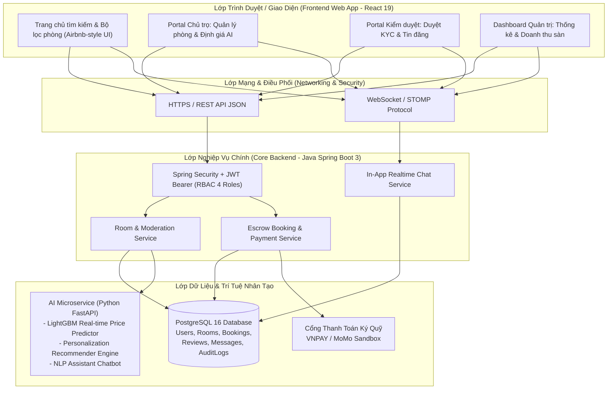

# Sàn Cho Thuê Phòng Trọ Thông Minh Tích Hợp Học Máy (Smart Room Rental Platform)

> **Dự án:** Sàn Thương Mại Điện Tử & Nền Tảng Cho Thuê Phòng Trọ Thông Minh Ứng Dụng Học Máy (AI / Machine Learning)  
> **Kiến trúc:** Java Spring Boot 3 (Core Backend) + React 19 (Frontend Web) + Python FastAPI / LightGBM (AI Microservice) + PostgreSQL 16  
> **Thư mục dự án:** `d:\Room rental platform`

---

## 1. Giới Thiệu Tổng Quan & Bối Cảnh Bài Toán (Project Overview)

Tìm kiếm và cho thuê phòng trọ tại các đô thị lớn (Hà Nội, TP.HCM, Đà Nẵng) hiện nay đang đối mặt với nhiều bất cập nhức nhối:
* **Đối với người đi thuê (Sinh viên, người đi làm):** Thường xuyên gặp "bẫy" phòng trọ ảo, giá đăng một đằng đến nơi đòi một nẻo, hình ảnh qua mạng bị phóng đại sai lệch thực tế, thiếu thông tin đánh giá khách quan.
* **Đối với chủ nhà trọ:** Tốn nhiều chi phí đăng tin trên nhiều hội nhóm Facebook rời rạc, khó định giá phòng chính xác theo biến động thị trường dẫn đến phòng bỏ trống lâu ngày.
* **Đối với đơn vị vận hành sàn:** Tốn công sức duyệt tin thủ công, khó phát hiện tin lừa đảo giả mạo chủ trọ.

**Giải pháp:** Nền tảng **Smart Room Rental Platform** giải quyết triệt để các vấn đề trên thông qua 3 trụ cột:
1. **Quy trình kiểm duyệt 2 vòng nghiêm ngặt:** Xác thực danh tính chủ trọ (CCCD/giấy tờ nhà) và phê duyệt chất lượng phòng trước khi hiển thị công khai.
2. **Trí tuệ nhân tạo (AI / Machine Learning):**
   * **Định giá phòng thời gian thực (Real-time Price Prediction):** Sử dụng mô hình **LightGBM** phân tích diện tích, quận/huyện, khoảng cách đến trường đại học/trung tâm, nội thất (điều hòa, máy giặt, nóng lạnh, ban công) để gợi ý mức giá thuê hợp lý nhất.
   * **Hệ thống gợi ý thông minh (Recommendation System):** Cá nhân hóa danh sách phòng dựa trên lịch sử tìm kiếm, tầm giá và thói quen xem phòng của người thuê.
   * **Trợ lý ảo Chatbot thông minh:** Chatbot hỗ trợ giải đáp nhanh 24/7 về tiện ích xung quanh, chính sách cọc và kết nối trực tiếp với chủ trọ.
3. **Thanh toán & Đặt cọc ký quỹ (Escrow Payment):** Tích hợp cổng thanh toán (VNPAY / MoMo) giữ tiền cọc an toàn 48h, bảo vệ người thuê khỏi lừa đảo và chỉ giải ngân cho chủ trọ sau khi người thuê đến nhận phòng thực tế thành công.

---

### 1.1 Product Mind Map

> **Sơ đồ tư duy sản phẩm:** Định hình toàn bộ 10 phân hệ chức năng theo chuẩn Top-Down, cân bằng giữa các phân hệ cốt lõi tạo đột phá (Định giá & Gợi ý AI, Kiểm duyệt 2 lớp, Ký quỹ Escrow) và các phân hệ bổ trợ vận hành.

---

## 2. Hệ Thống 4 Nhóm Vai Trò Người Dùng (RBAC Roles)

Hệ thống phân quyền nghiêm ngặt 4 vai trò độc lập:

1. **Quản Trị Viên (Admin):**
   * Giám sát toàn bộ hoạt động sàn, quản lý người dùng và cấp quyền.
   * Xem Dashboard phân tích doanh thu: Phí dịch vụ, hoa hồng từ các giao dịch đặt cọc giữ phòng.
2. **Người Kiểm Duyệt Viên (Moderator):**
   * Tiếp nhận hồ sơ đăng ký của Chủ trọ, xác thực tính đúng đắn của thông tin khai báo (đối soát CCCD).
   * Duyệt bài đăng phòng trọ mới (kiểm tra địa chỉ, hình ảnh, tiện ích, giá niêm yết) trước khi cho phép hiển thị trên sàn.
   * Kiểm duyệt các bài đánh giá / bình luận phản cảm, độc hại từ người dùng; xử lý khiếu nại cọc.
3. **Chủ Trọ (Landlord):**
   * Đăng ký tài khoản và hoàn thiện hồ sơ xác thực chủ nhà (KYC).
   * Tạo bài đăng phòng trọ mới, sử dụng công cụ AI LightGBM để tham khảo mức giá thị trường.
   * Quản lý trạng thái danh sách phòng (Còn trống, Đang giữ cọc, Đang có người ở, Đang bảo trì).
   * Tiếp nhận yêu cầu đặt cọc giữ phòng và chat trực tiếp với người thuê tiềm năng.
4. **Người Thuê Phòng (Tenant / Customer):**
   * Tìm kiếm, lọc phòng đa tiêu chí (khoảng giá, khu vực, tiện nghi, bán kính trường học/công ty).
   * Nhận gợi ý phòng phù hợp từ AI dựa trên lịch sử tương tác.
   * Chat hỏi đáp với trợ lý ảo hoặc nhắn tin trực tiếp với chủ trọ.
   * Đặt cọc giữ phòng trực tuyến qua cổng thanh toán VNPAY/MoMo.
   * Viết đánh giá, chấm điểm sao (1 - 5 sao) sau khi đã thuê phòng thực tế (Quy trình duyệt đánh giá 2 bước).

---

## 3. Kiến Trúc Kỹ Thuật Tổng Thể (System Architecture)

---

## 4. Lộ Trình Phát Triển Hệ Thống (Roadmap)

- [x] **Giai đoạn 1:** Phân tích đề bài Top-Down, xác định phạm vi sản phẩm (`docs/01-scope.md`) & Product Mind Map (`docs/images/mindmap.png`)
- [x] **Giai đoạn 2:** Danh mục 10 Phân hệ Tính năng (`docs/02-features.md`), 17 User Stories chuẩn INVEST (`docs/08-invest-requirements.md`) & Tiêu chí nghiệm thu chi tiết AC-UC01 -> AC-UC17 (`docs/06-acceptance-criteria.md`)
- [x] **Giai đoạn 3:** Sơ đồ Ca sử dụng (Use Case Diagrams) & Đặc tả 17 Use Cases (`docs/03-use-cases.md`)
- [x] **Giai đoạn 4:** Kiến trúc Thông tin (Information Architecture & Visual Sitemap) & Đặc tả 18 màn hình (`docs/04-information-architecture.md`)
- [x] **Giai đoạn 5:** Thiết kế Cơ sở Dữ liệu quan hệ ERD Mermaid & DBML 2.0 (`src/database/schema.dbml`, `docs/05-data-model.md`, `src/database/schema.sql`)
- [x] **Giai đoạn 6:** Đặc tả Hợp đồng REST API chuẩn OpenAPI 3.0.4 (`docs/api/openapi.yaml`, `docs/api/README.md`)
- [x] **Giai đoạn 7:** Thiết kế Kiến trúc C4 (C1 - C4) & Sơ đồ Tuần tự (`docs/architecture/c4/`)
- [x] **Giai đoạn 8:** Cấu trúc mã nguồn & Khung dự án Monorepo (`docs/07-folder-structure.md`, `src/`)
- [ ] **Giai đoạn 9:** Triển khai Module Học Máy AI (Mô hình LightGBM dự đoán giá & Recommender System)
- [ ] **Giai đoạn 10:** Triển khai mã nguồn Backend Java Spring Boot 3 & React 19 Frontend

