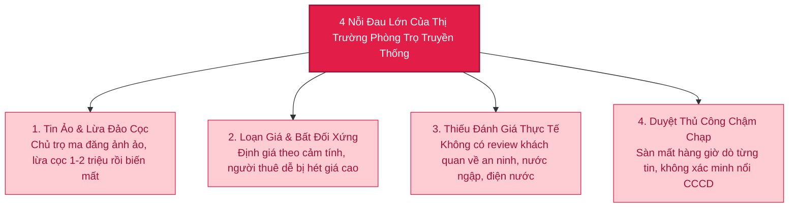
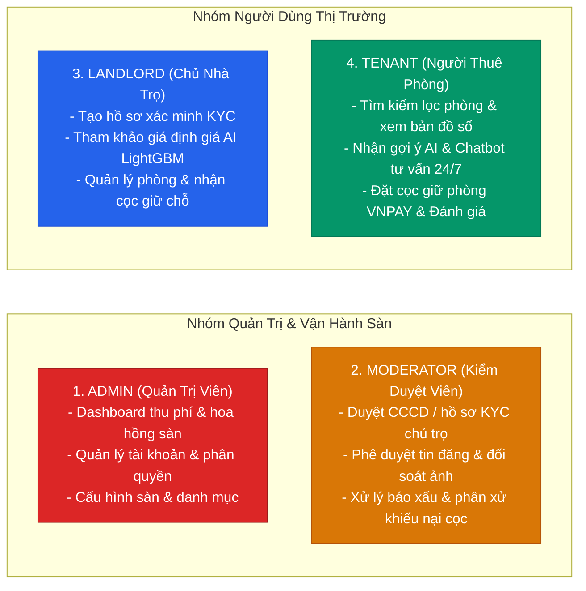

# Phân Tích Đề Bài Top-Down & Phạm Vi Hệ Thống (Scope & Problem Breakdown)

> **Dự án:** Sàn Cho Thuê Phòng Trọ Thông Minh Ứng Dụng Học Máy (Smart Room Rental Platform)  
> **Kiến trúc:** Java Spring Boot 3 + React 19 + Python FastAPI (LightGBM) + PostgreSQL 16  
> **Trạng thái:** TARGET V1 BASELINE (Sẵn sàng bảo vệ Hội đồng / Mentor)

---

## 1. Bối Cảnh Thị Trường & Nỗi Đau Thực Tế (Problem Statement)

Tại các đô thị tập trung đông trường đại học và khu công nghiệp (Hà Nội, TP.HCM, Đà Nẵng), thị trường phòng trọ truyền thống đang bộc lộ 4 nỗi đau nghiêm trọng:

---

## 2. Nghiên Cứu Đối Chuẩn Thị Trường (Competitive Benchmark Research)

Để chứng minh tính đột phá và sự cần thiết của đề tài, hệ thống được so sánh trực tiếp với các kênh tìm phòng trọ hiện có:

| Tiêu Chí So Sánh | Facebook Groups / Zalo | Chợ Tốt / Bất Động Sản | Phòng Trọ 123 | **Smart Rental Platform (Đề Tài)** |
| :--- | :---: | :---: | :---: | :---: |
| **Xác thực danh tính chủ trọ** | ❌ Không (Nhiều nick ảo) | ⚠️ Chỉ xác thực SĐT | ⚠️ Chỉ xác thực SĐT | ✅ **KYC 2 lớp qua CCCD & Giấy tờ phòng** |
| **Kiểm soát chất lượng tin đăng** | ❌ Không kiểm duyệt | ⚠️ Duyệt từ khóa cơ bản | ⚠️ Duyệt thủ công chậm | ✅ **Duyệt ảnh thực tế, đối soát địa chỉ thật** |
| **Định giá phòng bằng AI** | ❌ Không có | ❌ Không có | ❌ Không có | ✅ **LightGBM dự đoán giá & cảnh báo lệch giá** |
| **Gợi ý phòng cá nhân hóa** | ❌ Feed ngẫu nhiên | ⚠️ Theo chuyên mục | ⚠️ Tìm kiếm cơ bản | ✅ **Recommender Engine theo lịch sử tương tác** |
| **Bảo vệ tiền đặt cọc** | ❌ Tự chuyển khoản (Dễ mất) | ❌ Không hỗ trợ | ❌ Không hỗ trợ | ✅ **Ký quỹ Escrow (Giữ cọc 48h qua VNPAY)** |
| **Đánh giá & Review** | ❌ Dễ bị xóa / Nick ảo | ❌ Không có review phòng | ⚠️ Bình luận tự do | ✅ **Chỉ cho phép khách đã thuê thực tế đánh giá** |

---

## 3. Trụ Cột Giải Pháp Hệ Thống (Top-Down Solution Pillars)

Hệ thống được thiết kế theo mô hình Top-Down từ Mục tiêu chiến lược giải quyết triệt để 4 nỗi đau trên qua 3 trụ cột công nghệ:

### 3.1 Trụ Cột 1: Quy Trình Kiểm Duyệt 2 Lớp (Trust & 2-Step Verification)
* **Lớp 1 - Xác minh danh tính chủ trọ (Landlord KYC):** Chủ trọ khi đăng ký bắt buộc tải ảnh CCCD mặt trước/sau và Giấy xác nhận quyền sở hữu/ủy quyền quản lý phòng. Moderator xác minh đối soát trước khi mở khóa tính năng "Đăng tin".
* **Lớp 2 - Phê duyệt bài đăng phòng (Room Listing Quality Gate):** Mỗi phòng trọ tạo mới bắt buộc qua hàng đợi duyệt tin (kiểm tra địa chỉ thật trên bản đồ, chống ảnh mạng/ảnh rác, đối soát giá niêm yết so với phân tích của AI).

### 3.2 Trụ Cột 2: Lõi Trí Tuệ Nhân Tạo & Học Máy (Machine Learning Core)
1. **Mô hình Định giá phòng thời gian thực (LightGBM Price Predictor):**
   * **Vector đặc trưng (Features):** Diện tích ($m^2$), Quận/Huyện, Loại hình phòng, Khoảng cách đến trạm xe buýt / các trường ĐH lớn, Tiện nghi (Điều hòa, Nóng lạnh, Máy giặt, Tủ lạnh, Ban công, Thang máy, Giờ giấc tự do).
   * **Đầu ra:** Mức giá gợi ý trung bình $\hat{Y}$, khoảng giá khuyến nghị an toàn $[Y_{\min}, Y_{\max}]$, và tỷ lệ lệch giá so với thị trường.
   * **Chiến lược dữ liệu (Data Strategy):** Sử dụng tập dữ liệu thực tế đã chuẩn hóa từ thị trường phòng trọ Hà Nội/TP.HCM (hơn 10,000 bản ghi sạch), huấn luyện qua LightGBM Regressor đạt độ chính xác cao với sai số $MAPE < 10\%$.
2. **Hệ thống Gợi ý Cá nhân hóa (Recommendation Engine):**
   * Kết hợp Lọc theo nội dung (Content-based: lọc theo khoảng cách trường ĐH, mức giá quan tâm) và Lọc cộng tác (Collaborative Filtering: dựa trên lịch sử click xem phòng, lưu tin).
   * **Giải quyết bài toán Cold-Start (Người dùng mới):** Tự động fallback về gợi ý các phòng có điểm chất lượng cao nhất quanh trường học hoặc khu vực mà người dùng vừa tìm kiếm.
3. **Trợ lý ảo AI Chatbot:**
   * Chatbot hỗ trợ 24/7 giải đáp thắc mắc về tiện ích khu vực, giá điện nước quy định, và kết nối nhanh với chủ trọ.

### 3.3 Trụ Cột 3: Đặt Cọc Ký Quỹ (Escrow) & Đánh Giá Minh Bạch
* **Cơ chế Ký quỹ Giữ cọc an toàn (Escrow Payment):** Người thuê thanh toán số tiền cọc giữ chỗ 24-48 giờ qua VNPAY / MoMo. Số tiền được Sàn tạm giữ an toàn, phòng chuyển trạng thái "Đang giữ cọc".
* **Cơ chế Phân xử tranh chấp minh bạch (Dispute Resolution Flow):**
  * *Trường hợp 1 (Thành công):* Khách đến xem đúng cam kết, ký hợp đồng -> Sàn giải ngân tiền cọc cho chủ trọ.
  * *Trường hợp 2 (Phòng sai thực tế):* Phòng ẩm mốc, thiếu đồ so với tin đăng -> Khách gửi khiếu nại kèm ảnh/video trong vòng 24h -> Moderator đối soát với dữ liệu duyệt tin ban đầu và **hoàn cọc 100% cho người thuê**.
  * *Trường hợp 3 (Khách bùng hẹn):* Khách tự ý hủy mà không có lý do chính đáng -> Bồi hoàn cọc cho chủ trọ.
* **Đánh giá 2 bước (Verified Reviews):** Chỉ tài khoản đã phát sinh giao dịch cọc và nhận phòng thực tế mới được quyền đánh giá theo 4 tiêu chí (An ninh, Vệ sinh, Điện nước, Thái độ chủ trọ), loại bỏ hoàn toàn review ảo.

---

## 4. Mục Tiêu Định Lượng & Chỉ Số Thành Công (Quantifiable KPIs)

Đề tài đặt ra các chỉ số thành công cụ thể, có thể đo lường và nghiệm thu rõ ràng:

| Chỉ Số Thành Công (Metric) | Thực Trạng Thị Trường | Mục Tiêu Đạt Được Với Smart Rental | Phương Pháp Đo Lường |
| :--- | :---: | :---: | :--- |
| **Tỷ lệ tin ảo / lừa đảo cọc** | ~35% - 40% | **< 1%** | Tỷ lệ báo cáo tin giả mạo được xác minh / Tổng số tin |
| **Thời gian tìm phòng thành công** | 7 - 14 ngày | **< 48 giờ** | Thời gian từ lúc đăng ký đến lúc phát sinh giao dịch cọc |
| **Độ chính xác mô hình định giá AI** | Không có (cảm tính) | **MAPE < 10%** | Sai số phần trăm tuyệt đối trung bình trên tập Test |
| **Thời gian phản hồi kiểm duyệt (SLA)** | 12 - 24 giờ | **< 4 giờ** | Thời gian trung bình Moderator duyệt tin phòng mới |
| **Tỷ lệ giao dịch cọc an toàn** | Rủi ro cao | **100%** | Không có khiếu nại mất cọc ngoài tầm kiểm soát của sàn |

---

## 5. Bản Đồ Ma Trận 4 Nhóm Vai Trò (RBAC User Roles)

---

## 6. Ranh Giới Phạm Vi Sản Phẩm V1 (In-Scope vs Out-of-Scope)

### Trong phạm vi V1 (In-Scope):
* **Xác thực & Bảo mật:** Đăng nhập JWT (Access & Refresh Tokens), phân quyền 4 nhóm vai trò (Admin, Moderator, Landlord, Tenant).
* **Quy trình KYC & Duyệt tin:** Tải ảnh CCCD xác minh chủ nhà, hàng đợi kiểm duyệt tin đăng phòng kèm upload ảnh.
* **Tìm kiếm & Trải nghiệm:** Bộ lọc đa tiêu chí theo bán kính trường đại học, hiển thị bản đồ số và widget so sánh giá AI.
* **Microservice AI:** Python FastAPI chạy mô hình LightGBM dự đoán giá phòng và thuật toán gợi ý phòng cá nhân hóa.
* **Ký quỹ Escrow:** Quy trình đặt cọc giữ chỗ qua cổng Sandbox VNPAY và cơ chế giải ngân/hoàn cọc minh bạch.
* **Đánh giá sau thuê:** Đánh giá 4 tiêu chí chỉ dành cho khách đã hoàn tất thuê phòng.
* **Quản trị:** Dashboard thống kê doanh thu cọc, tỷ lệ phòng trống và báo cáo vi phạm.

### Ngoài phạm vi V1 (Out-of-Scope / Định hướng V2):
* Ký hợp đồng thuê nhà điện tử qua chữ ký số cá nhân (PKI/eKYC FPT).
* Tự động thu tiền điện nước hàng tháng qua Smart Meter (công tơ điện IoT thông minh).
* Ứng dụng di động Native iOS/Android (Tập trung hoàn thiện giao diện Responsive Web chuẩn Airbnb-style trên React 19).
