# Actors, Roles & Use Cases — Smart Rental Platform

> **Trạng thái thiết kế:** TARGET V1 BASELINE  
> **Kiến trúc liên quan:** Java Spring Boot 3 + React 19 + Python FastAPI (LightGBM) + PostgreSQL 16  
> **Tài liệu liên kết:** [`docs/08-invest-requirements.md`](./08-invest-requirements.md) | [`docs/01-scope.md`](./01-scope.md)

---

## 1. Tác Nhân & Phân Quyền (Actors & Roles)

Hệ thống được vận hành bởi 4 tác nhân chính (Actors) thông qua cơ chế phân quyền RBAC (Role-Based Access Control) nghiêm ngặt:

| Mã Vai Trò (Role) | Tên Hiển Thị (Display Name) | Trách Nhiệm & Quyền Hạn Chính |
| :--- | :--- | :--- |
| `ADMIN` | Quản trị viên sàn | Giám sát toàn bộ hệ thống, quản lý tài khoản người dùng, xem báo cáo doanh thu cọc & phí sàn, cấu hình danh mục. |
| `MODERATOR` | Kiểm duyệt viên | Xác minh hồ sơ KYC của Chủ trọ (đối soát CCCD), kiểm duyệt tin đăng phòng (chống tin ảo), xử lý khiếu nại tranh chấp cọc. |
| `LANDLORD` | Chủ nhà trọ | Nộp hồ sơ KYC, đăng tin cho thuê phòng, tham khảo giá định giá AI (LightGBM), quản lý trạng thái phòng, nhận cọc, chat với khách. |
| `TENANT` | Khách thuê phòng | Tìm kiếm lọc phòng đa tiêu chí, xem bản đồ, nhận gợi ý AI cá nhân hóa, chat tư vấn, đặt cọc giữ chỗ qua VNPAY, đánh giá sau lưu trú. |

---

## 2. Ma Trận Vai Trò × Tính Năng (Role × Feature Matrix)

| Chức Năng (Feature) | Mã UC | Thuộc Phân Hệ | ADMIN | MODERATOR | LANDLORD | TENANT |
| :--- | :---: | :---: | :---: | :---: | :---: | :---: |
| Đăng ký & Đăng nhập (JWT) | **UC01** | F01 | ✓ | ✓ | ✓ | ✓ |
| Quản lý Hồ sơ & Đổi mật khẩu | **UC02** | F02 | ✓ | ✓ | ✓ | ✓ |
| Nộp hồ sơ xác minh KYC (CCCD) | **UC03** | F03 | | | ✓ | |
| Phê duyệt hồ sơ KYC Chủ trọ | **UC04** | F03 | ✓ | ✓ | | |
| Tạo & Cập nhật tin đăng phòng | **UC05** | F04 | | | ✓ (Đã KYC) | |
| Dự đoán giá phòng AI (LightGBM) | **UC06** | F06 | | | ✓ | ✓ (Xem tham chiếu) |
| Kiểm duyệt tin đăng phòng | **UC07** | F05 | ✓ | ✓ | | |
| Tìm kiếm & Lọc phòng đa tiêu chí | **UC08** | F07 | ✓ | ✓ | ✓ | ✓ |
| Xem chi tiết phòng & Bản đồ số | **UC09** | F07 | ✓ | ✓ | ✓ | ✓ |
| Nhận gợi ý phòng cá nhân hóa (AI) | **UC10** | F06 | | | | ✓ |
| Hỏi đáp Trợ lý ảo AI Chatbot | **UC11** | F06 | | | ✓ | ✓ |
| Đặt cọc giữ phòng ký quỹ (VNPAY) | **UC12** | F08 | | | Nhận cọc | Đặt cọc |
| Xử lý khiếu nại tranh chấp cọc | **UC13** | F09 | ✓ | Phân xử | Bên liên quan | Bên khiếu nại |
| Nhắn tin trực tiếp (WebSocket) | **UC14** | F10 | | | ✓ | ✓ |
| Đánh giá sau lưu trú (2 bước) | **UC15** | F10 | Kiểm duyệt | Kiểm duyệt | Phản hồi | Viết đánh giá |
| Quản trị người dùng & Khóa tài khoản | **UC16** | F10 | ✓ | | | |
| Dashboard thống kê & Doanh thu sàn | **UC17** | F10 | ✓ (Toàn sàn) | Báo cáo duyệt | ✓ (Phòng của tôi) | |

---

## 3. Sơ Đồ Ca Sử Dụng Tổng Thể (Use Case Diagram)

Sơ đồ thể hiện trực quan ranh giới hệ thống (**System Boundary**) và luồng tương tác của 4 tác nhân. Tác nhân quản trị/vận hành (`Admin`, `Moderator`) bố trí bên trái; tác nhân người dùng thị trường (`Landlord`, `Tenant`) bố trí bên phải.

```mermaid
flowchart LR
    subgraph leftActors["Vận Hành & Quản Trị"]
        direction TB
        admin(["Admin<br/>(Quản trị viên)"])
        moderator(["Moderator<br/>(Kiểm duyệt viên)"])
    end

    subgraph system["Smart Rental Platform — Ranh Giới Hệ Thống"]
        direction TB
        
        subgraph authGroup["1. Xác thực & Hồ sơ"]
            direction LR
            uc01["UC01: Đăng nhập / Đăng ký"]
            uc02["UC02: Quản lý hồ sơ & Mật khẩu"]
        end

        subgraph trustGroup["2. Kiểm duyệt & Xác minh 2 lớp"]
            direction LR
            uc03["UC03: Nộp hồ sơ KYC"]
            uc04["UC04: Duyệt hồ sơ KYC"]
            uc07["UC07: Duyệt tin đăng phòng"]
            uc13["UC13: Phân xử khiếu nại cọc"]
        end

        subgraph aiGroup["3. Trí tuệ Nhân tạo & Học máy"]
            direction LR
            uc06["UC06: Dự đoán giá LightGBM"]
            uc10["UC10: Gợi ý phòng cá nhân hóa"]
            uc11["UC11: Chatbot tư vấn 24/7"]
        end

        subgraph discoveryGroup["4. Khám phá & Giao dịch"]
            direction LR
            uc05["UC05: Đăng & Quản lý tin phòng"]
            uc08["UC08: Tìm kiếm & Lọc đa tiêu chí"]
            uc09["UC09: Xem phòng & Bản đồ số"]
            uc12["UC12: Đặt cọc Escrow (VNPAY)"]
            uc14["UC14: Chat trực tiếp Khách - Chủ"]
            uc15["UC15: Đánh giá sau lưu trú"]
        end

        subgraph adminGroup["5. Quản trị & Báo cáo"]
            direction LR
            uc16["UC16: Quản trị tài khoản"]
            uc17["UC17: Dashboard & Doanh thu"]
        end
    end

    subgraph rightActors["Người Dùng Thị Trường"]
        direction TB
        landlord(["Landlord<br/>(Chủ nhà trọ)"])
        tenant(["Tenant<br/>(Khách thuê)"])
    end

    %% Luồng quyền Admin
    admin --> uc01
    admin --> uc02
    admin --> uc04
    admin --> uc07
    admin --> uc13
    admin --> uc16
    admin --> uc17

    %% Luồng quyền Moderator
    moderator --> uc01
    moderator --> uc02
    moderator --> uc04
    moderator --> uc07
    moderator --> uc13
    moderator --> uc15

    %% Luồng quyền Landlord (Chủ trọ)
    landlord --> uc01
    landlord --> uc02
    landlord --> uc03
    landlord --> uc05
    landlord --> uc06
    landlord --> uc12
    landlord --> uc14
    landlord --> uc15
    landlord --> uc17

    %% Luồng quyền Tenant (Người thuê)
    tenant --> uc01
    tenant --> uc02
    tenant --> uc06
    tenant --> uc08
    tenant --> uc09
    tenant --> uc10
    tenant --> uc11
    tenant --> uc12
    tenant --> uc13
    tenant --> uc14
    tenant --> uc15

    classDef adminStyle fill:#dc2626,stroke:#991b1b,stroke-width:2px,color:#fff;
    classDef modStyle fill:#d97706,stroke:#b45309,stroke-width:2px,color:#fff;
    classDef landlordStyle fill:#2563eb,stroke:#1d4ed8,stroke-width:2px,color:#fff;
    classDef tenantStyle fill:#059669,stroke:#047857,stroke-width:2px,color:#fff;

    class admin adminStyle;
    class moderator modStyle;
    class landlord landlordStyle;
    class tenant tenantStyle;
```

---

## 4. Đặc Tả Chi Tiết 17 Ca Sử Dụng (Detailed Use Case Specifications)

### UC01: Đăng Ký & Đăng Nhập Hệ Thống
* **Tác nhân:** Tất cả (Admin, Moderator, Landlord, Tenant).
* **Tiền điều kiện:** Người dùng có tài khoản hợp lệ hoặc email chưa từng đăng ký.
* **Kích hoạt:** Nhấp vào nút "Đăng nhập" hoặc "Đăng ký" trên thanh điều hướng.
* **Luồng chính (Main Flow):**
  1. Người dùng nhập Email, Mật khẩu (kèm Tên và Số điện thoại nếu đăng ký).
  2. Hệ thống kiểm tra định dạng dữ liệu và tính duy nhất của email.
  3. Backend mã hóa mật khẩu (BCrypt), lưu thông tin và cấp JWT Access Token (hạn 30 phút) + Refresh Token.
  4. Client lưu trữ Token và chuyển hướng về đúng Dashboard tương ứng theo vai trò.
* **Luồng ngoại lệ (Alternative Flow):**
  - Mật khẩu không đúng hoặc tài khoản bị khóa -> Báo lỗi `401 Unauthorized` hoặc `403 Account Disabled`.

### UC02: Quản Lý Hồ Sơ & Đổi Mật Khẩu
* **Tác nhân:** Người dùng đã đăng nhập.
* **Luồng chính:** Xem thông tin cá nhân, cập nhật số điện thoại, đổi avatar, nhập mật khẩu cũ để đổi mật khẩu mới.

### UC03: Nộp Hồ Sơ Xác Minh KYC Chủ Trọ
* **Tác nhân:** Landlord.
* **Tiền điều kiện:** Landlord đã đăng nhập nhưng tài khoản có trạng thái `UNVERIFIED`.
* **Luồng chính:**
  1. Chủ trọ tải lên ảnh chụp 2 mặt CCCD và ảnh giấy tờ chứng minh quyền sở hữu/ủy quyền quản lý phòng trọ.
  2. Hệ thống kiểm tra định dạng ảnh (JPG/PNG, dung lượng < 5MB) và lưu trữ bảo mật trên Cloud Storage.
  3. Hệ thống tạo bản ghi KYC ở trạng thái `PENDING_VERIFICATION` và đưa vào hàng đợi kiểm duyệt.

### UC04: Phê Duyệt Hồ Sơ KYC Chủ Trọ
* **Tác nhân:** Moderator, Admin.
* **Luồng chính:**
  1. Moderator truy cập hàng đợi duyệt KYC, xem ảnh CCCD và đối chiếu thông tin khai báo.
  2. Moderator chọn **Phê duyệt (Approve)** hoặc **Từ chối (Reject)** kèm lý do cụ thể (ảnh mờ, sai thông tin).
  3. Nếu duyệt: Tài khoản chủ trọ được nâng cấp trạng thái `VERIFIED_LANDLORD`, mở khóa quyền đăng tin.

### UC05: Tạo & Cập Nhật Tin Đăng Phòng Trọ
* **Tác nhân:** Landlord (Đã hoàn tất KYC).
* **Luồng chính:**
  1. Chủ trọ nhập thông tin phòng: Tiêu đề, Địa chỉ chi tiết (Quận/Huyện, Tọa độ GPS), Diện tích ($m^2$), Giá thuê, Tiền cọc, Giá điện/nước.
  2. Chọn danh sách tiện nghi: Điều hòa, Nóng lạnh, Máy giặt, Ban công, Thang máy, Giờ tự do...
  3. Tải lên từ 3 đến 10 ảnh thực tế của căn phòng.
  4. Hệ thống lưu tin ở trạng thái `PENDING_APPROVAL` và chuyển tiếp sang hàng đợi duyệt tin.

### UC06: Dự Đoán Giá Phòng Thời Gian Thực (LightGBM)
* **Tác nhân:** Landlord (Khi tạo tin), Tenant (Khi xem phòng).
* **Luồng chính:**
  1. Hệ thống gửi vector đặc trưng `[dien_tich, quan_huyen, loai_phong, tien_nghi, toa_do]` sang AI Microservice (Python FastAPI).
  2. Mô hình LightGBM tính toán và trả về mức giá dự đoán $\hat{Y}$ cùng khoảng giá khuyến nghị $[Y_{\min}, Y_{\max}]$.
  3. Giao diện hiển thị widget trực quan: So sánh giá chủ trọ đặt với giá thị trường và đưa ra khuyến nghị tối ưu.

### UC07: Phê Duyệt Bài Đăng Phòng Trọ
* **Tác nhân:** Moderator, Admin.
* **Luồng chính:**
  1. Moderator kiểm tra hình ảnh thực tế (chống ảnh biệt thự/ảnh mạng), kiểm tra địa chỉ tồn tại trên bản đồ.
  2. Đối chiếu giá niêm yết với gợi ý AI. Nếu giá cao bất thường (> 35%), hệ thống bật cờ cảnh báo để xem xét kỹ.
  3. Moderator chọn **Duyệt bài (Publish)** -> Tin đăng chuyển sang `APPROVED` và hiển thị công khai trên Sàn.

### UC08: Tìm Kiếm & Lọc Phòng Đa Tiêu Chí
* **Tác nhân:** Tenant, Khách vãng lai.
* **Luồng chính:**
  1. Người dùng nhập tên trường đại học / địa điểm làm việc (ví dụ: "Đại học Bách Khoa Hà Nội").
  2. Chọn bộ lọc: Bán kính (< 2km, < 5km), Khoảng giá (1-2 triệu, 2-4 triệu, > 4 triệu), Diện tích, Tiện nghi.
  3. Hệ thống truy vấn cơ sở dữ liệu PostgreSQL sử dụng không gian địa lý (PostGIS/GiST) và trả về kết quả nhanh chóng (< 200ms).

### UC09: Xem Chi Tiết Phòng & Bản Đồ Số
* **Tác nhân:** Tenant, Khách vãng lai.
* **Luồng chính:** Xem album ảnh chất lượng cao, thông số chi tiết, bảng kê giá điện nước, vị trí trên bản đồ tương tác, và widget so sánh giá AI.

### UC10: Nhận Gợi Ý Phòng Cá Nhân Hóa (AI Recommender)
* **Tác nhân:** Tenant đã đăng nhập.
* **Luồng chính:**
  1. Khi Tenant truy cập trang chủ, hệ thống tự động phân tích lịch sử click xem phòng, danh sách phòng đã lưu và khoảng giá quan tâm.
  2. Recommender Engine trả về danh sách Top 10 phòng phù hợp nhất.
  3. Nếu là người dùng mới (Cold-Start): Fallback hiển thị các phòng có lượt đánh giá cao nhất quanh các trường đại học lớn.

### UC11: Hỏi Đáp Trợ Lý Ảo AI Chatbot
* **Tác nhân:** Tenant, Landlord.
* **Luồng chính:** Tenant đặt câu hỏi nhanh qua widget chat (ví dụ: "Khu vực này có trạm xe bus gần không?", "Chủ trọ có cho nuôi thú cưng không?"). Chatbot tự động phân tích dữ liệu tin đăng và phản hồi tức thì.

### UC12: Đặt Cọc Giữ Phòng Trực Tuyến (Escrow Booking)
* **Tác nhân:** Tenant, Landlord.
* **Luồng chính:**
  1. Tenant chọn phòng ưng ý, bấm "Đặt cọc giữ chỗ 48h" (số tiền cọc ví dụ 500,000 VNĐ).
  2. Hệ thống tạo giao dịch cọc ở trạng thái `WAITING_PAYMENT` và chuyển hướng sang cổng thanh toán VNPAY Sandbox.
  3. Tenant thanh toán thành công -> VNPAY gửi IPN webhook về Backend -> Phòng tự động chuyển sang `RESERVED`, tiền cọc được Sàn tạm giữ (Ký quỹ).
  4. Hệ thống gửi thông báo và lịch hẹn xem phòng cho cả Chủ trọ và Khách thuê.

### UC13: Xử Lý Khiếu Nại Tranh Chấp Cọc
* **Tác nhân:** Tenant, Landlord, Moderator.
* **Luồng chính:**
  1. Nếu Tenant đến xem phòng và phát hiện phòng không đúng mô tả (thiếu điều hòa, ẩm mốc nặng), Tenant bấm "Khiếu nại hoàn cọc" trong vòng 24h và tải lên ảnh/video bằng chứng.
  2. Moderator tiếp nhận hồ sơ khiếu nại, đối soát với ảnh tin đăng lúc duyệt.
  3. Moderator ra phán quyết: Hoàn trả 100% cọc cho Tenant hoặc giải ngân cho Landlord (nếu Tenant tự ý hủy vô lý).

### UC14: Nhắn Tin Trực Tiếp (In-app Chat)
* **Tác nhân:** Tenant, Landlord.
* **Luồng chính:** Trao đổi tin nhắn thời gian thực qua giao thức WebSocket (STOMP), chia sẻ hình ảnh phòng và vị trí hẹn gặp.

### UC15: Đánh Giá Sau Lưu Trú (Verified Reviews)
* **Tác nhân:** Tenant (Đã hoàn tất thuê), Moderator (Kiểm duyệt phản cảm).
* **Luồng chính:**
  1. Chỉ Tenant đã qua bước cọc và xác nhận nhận phòng thành công mới được mở khóa form đánh giá.
  2. Tenant chấm sao (1-5 sao) theo 4 tiêu chí: An ninh, Vệ sinh, Điện nước, Thái độ chủ trọ kèm nội dung nhận xét và ảnh thực tế.
  3. Bài đánh giá hiển thị công khai trên trang chi tiết phòng.

### UC16: Quản Trị Người Dùng & Phân Quyền
* **Tác nhân:** Admin.
* **Luồng chính:** Xem danh sách toàn bộ người dùng, tìm kiếm theo email/SĐT, phân vai trò (Admin, Moderator), kích hoạt hoặc khóa vĩnh viễn tài khoản có hành vi gian lận.

### UC17: Dashboard Thống Kê & Doanh Thu Sàn
* **Tác nhân:** Admin, Landlord.
* **Luồng chính:**
  - Admin: Xem tổng doanh thu phí sàn, tổng số tiền cọc đang lưu ký, biểu đồ tỷ lệ tin đăng được duyệt, tỷ lệ phòng trống theo quận huyện.
  - Landlord: Xem tổng số lượt xem phòng, danh sách phòng đang trống và doanh thu cọc nhận được.
