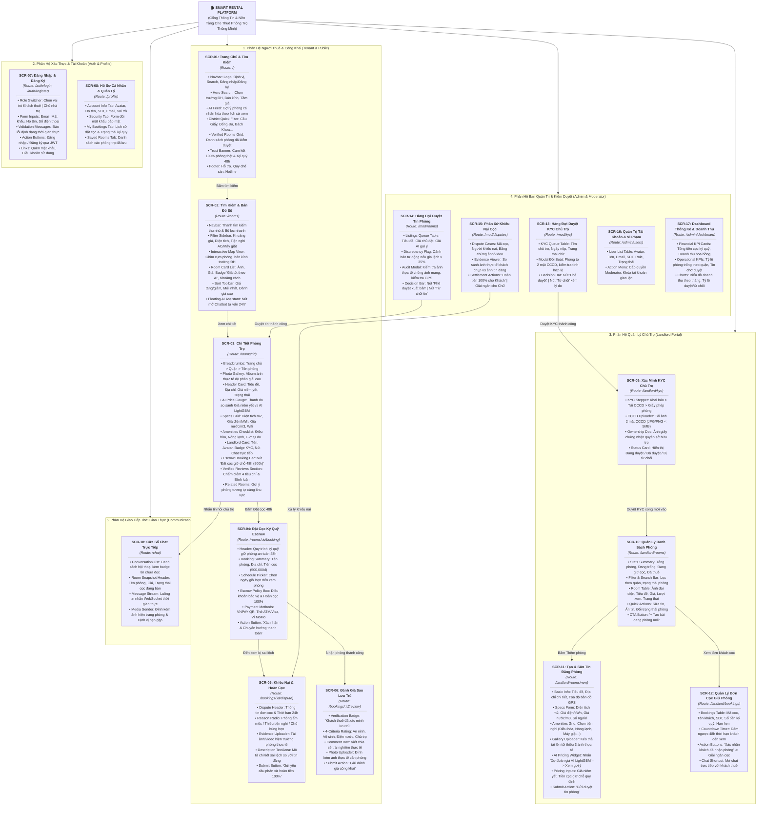
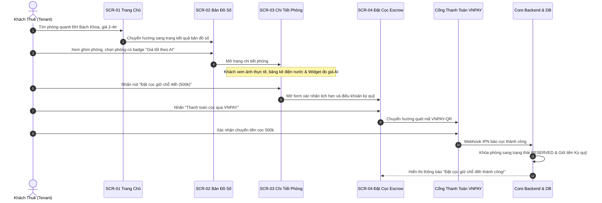
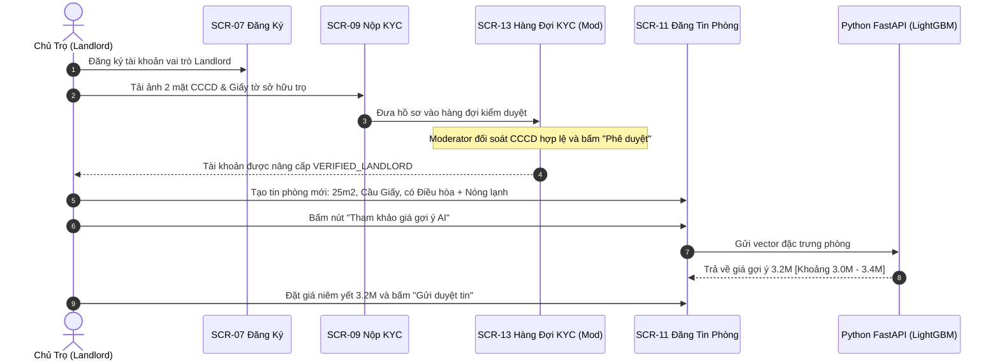
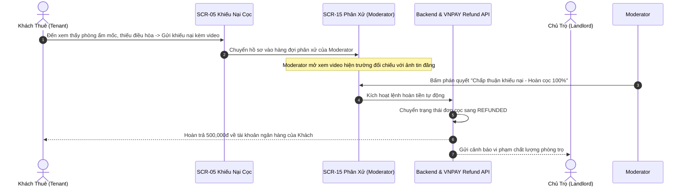

# Kiến Trúc Thông Tin Toàn Diện (Information Architecture & Visual Sitemap)

> **Dự án:** Sàn Cho Thuê Phòng Trọ Thông Minh (Smart Rental Platform)  
> **Trạng thái thiết kế:** TARGET V1 BASELINE  
> **Mục tiêu:** Định nghĩa chi tiết toàn bộ các màn hình giao diện (Screens), cấu trúc từng phân vùng (Sections/Blocks), chức năng thành phần và luồng điều hướng của 4 nhóm vai trò người dùng (Admin, Moderator, Landlord, Tenant).

---

## 1. Sơ Đồ Cây Kiến Trúc Thông Tin Tổng Thể (Visual Sitemap Diagram)

Sơ đồ trực quan hóa toàn bộ 18 màn hình của hệ thống. Mỗi màn hình được thiết kế theo chuẩn **Card-based Sitemap** (tương tự Relume Sitemap), liệt kê rõ ràng các **Sections, Khối thành phần và Chức năng chi tiết** bên trong màn hình:

---

## 2. Danh Mục & Đặc Tả Chi Tiết 18 Màn Hình (Screen Inventory)

| Mã Màn | Tên Màn Hình | Đường Dẫn (Route) | Phân Quyền (Roles) | Nhóm Mục Tiêu & Chức Năng Cốt Lõi |
| :---: | :--- | :--- | :--- | :--- |
| **SCR-01** | Trang Chủ & Tìm Kiếm | `/` | Tất cả (Public) | Thanh tìm kiếm theo trường ĐH, Feed gợi ý AI theo lịch sử xem, cụm quận huyện nổi bật. |
| **SCR-02** | Danh Sách Phòng & Bản Đồ | `/rooms` | Tất cả (Public) | Bộ lọc đa tiêu chí (giá, diện tích, tiện nghi), bản đồ số tương tác ghim cụm phòng, sắp xếp kết quả. |
| **SCR-03** | Chi Tiết Phòng Trọ | `/rooms/:id` | Tất cả (Public) | Album ảnh thực tế, bảng kê chi phí điện nước, **Widget đo giá AI LightGBM**, thông tin chủ trọ KYC, nút cọc. |
| **SCR-04** | Đặt Cọc Ký Quỹ Escrow | `/rooms/:id/booking` | TENANT | Hẹn lịch xem phòng 48h, chọn cổng VNPAY/MoMo, điều khoản ký quỹ bảo vệ tiền cọc 100%. |
| **SCR-05** | Khiếu Nại & Hoàn Cọc | `/bookings/:id/dispute` | TENANT | Gửi khiếu nại trong 24h kèm ảnh/video phòng ẩm mốc/thiếu đồ để Moderator hoàn tiền 100%. |
| **SCR-06** | Đánh Giá Sau Lưu Trú | `/bookings/:id/review` | TENANT (Đã thuê) | Đánh giá 4 tiêu chí (An ninh, Vệ sinh, Điện nước, Chủ trọ), huy hiệu xác minh thuê thật. |
| **SCR-07** | Đăng Nhập & Đăng Ký | `/auth/login`, `/auth/register` | Public | Đăng nhập/đăng ký qua JWT Bearer, chọn vai trò Tenant hoặc Landlord, mã hóa BCrypt. |
| **SCR-08** | Hồ Sơ Cá Nhân | `/profile` | Tất cả (Đã login) | Cập nhật thông tin cá nhân, đổi mật khẩu, xem danh sách đơn cọc và phòng đã lưu. |
| **SCR-09** | Xác Minh KYC Chủ Trọ | `/landlord/kyc` | LANDLORD | Tải ảnh 2 mặt CCCD + Giấy chứng nhận quyền sở hữu trọ để mở quyền đăng tin. |
| **SCR-10** | Quản Lý Danh Sách Phòng | `/landlord/rooms` | LANDLORD | Thống kê phòng trống/đang cọc/đang thuê, quản lý danh sách phòng, đổi trạng thái nhanh. |
| **SCR-11** | Tạo & Sửa Tin Đăng Phòng | `/landlord/rooms/new` | LANDLORD (Đã KYC) | Nhập thông số phòng, tải ảnh thực tế, **công cụ AI LightGBM gợi ý giá thị trường & cảnh báo lệch giá**. |
| **SCR-12** | Quản Lý Đơn Cọc Giữ Phòng | `/landlord/bookings` | LANDLORD | Xem danh sách khách cọc, đếm ngược 48h, nút xác nhận khách nhận phòng để giải ngân cọc. |
| **SCR-13** | Hàng Đợi Duyệt KYC Chủ Trọ | `/mod/kyc` | MODERATOR, ADMIN | Đối soát ảnh 2 mặt CCCD của chủ nhà, phê duyệt cấp quyền đăng tin hoặc từ chối kèm lý do. |
| **SCR-14** | Hàng Đợi Duyệt Tin Phòng | `/mod/rooms` | MODERATOR, ADMIN | Kiểm tra ảnh thực tế chống ảnh mạng, kiểm tra tọa độ GPS, cờ cảnh báo giá chênh lệch AI > 35%. |
| **SCR-15** | Phân Xử Khiếu Nại Cọc | `/mod/disputes` | MODERATOR, ADMIN | Đối chiếu ảnh hiện trường khách tải lên vs ảnh tin đăng lúc duyệt, quyết định hoàn tiền hoặc giải ngân. |
| **SCR-16** | Quản Trị Tài Khoản & Vi Phạm | `/admin/users` | ADMIN | Tìm kiếm người dùng, phân quyền Moderator, khóa tài khoản vi phạm lừa đảo cọc. |
| **SCR-17** | Dashboard Thống Kê Sàn | `/admin/dashboard` | ADMIN | Tổng doanh thu hoa hồng sàn, tổng tiền cọc đang lưu ký, biểu đồ tỷ lệ duyệt/từ chối tin. |
| **SCR-18** | Cửa Sổ Chat Trực Tiếp | `/chat` | TENANT, LANDLORD | Nhắn tin thời gian thực qua WebSocket STOMP, đính kèm ảnh hiện trạng và định vị hẹn gặp. |

---

## 3. Luồng Điều Hướng Trọng Tâm Của 3 Kịch Bản Nghiệp Vụ Cốt Lõi

### Luồng 1: Người Thuê Tìm Phòng & Đặt Cọc Ký Quỹ An Toàn (Tenant Journey)

### Luồng 2: Chủ Trọ Đăng Ký, Xác Minh KYC & Đăng Tin Có AI Định Giá (Landlord Journey)

### Luồng 3: Xử Lý Khiếu Nại & Hoàn Cọc Tự Động (Dispute & Refund Journey)

