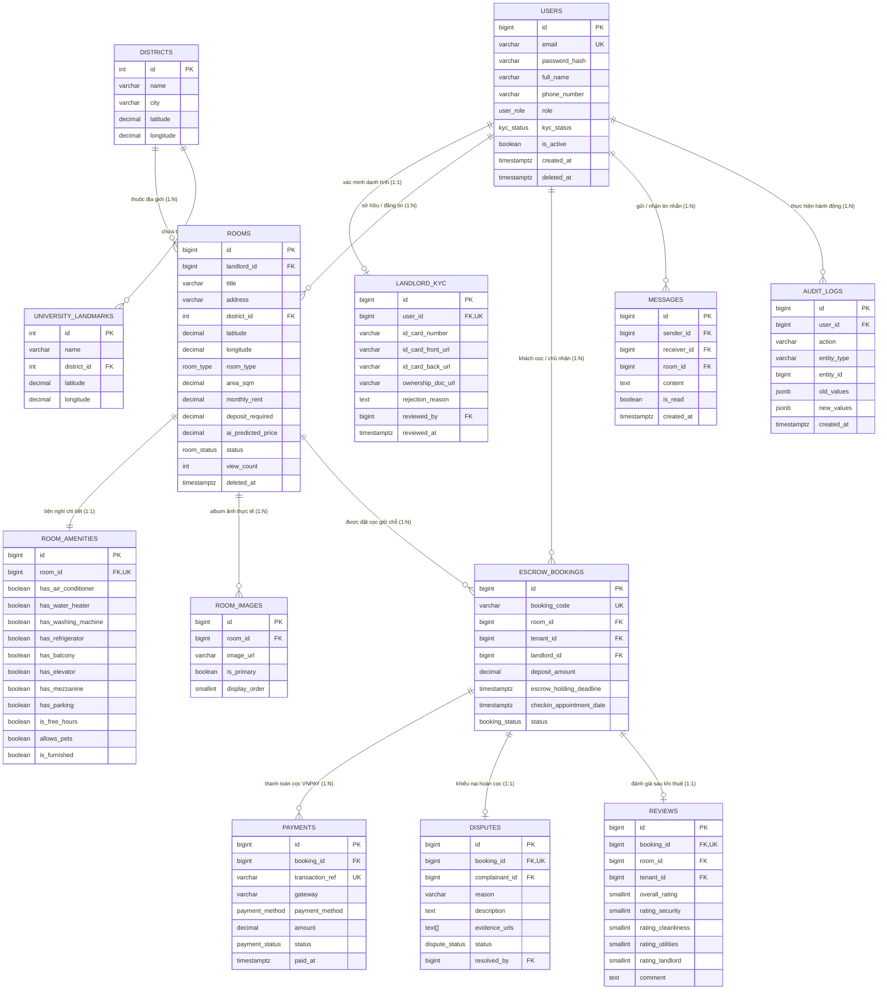

# Thiết Kế Cơ Sở Dữ Liệu & Mô Hình Dữ Liệu (PostgreSQL 16 Data Model & ERD)

> **Dự án:** Sàn Cho Thuê Phòng Trọ Thông Minh (Smart Rental Platform)  
> **Trạng thái thiết kế:** TARGET V1 BASELINE  
> **Hệ quản trị CSDL:** PostgreSQL 16 (Hỗ trợ JSONB, PostGIS Geolocation, Partial Indexing)  
> **Tài liệu nguồn liên quan:** [`src/database/schema.dbml`](../src/database/schema.dbml) | [`src/database/schema.sql`](../src/database/schema.sql)

---

## 1. Sơ Đồ Thực Thể Quan Hệ Tổng Thể (Mermaid ERD)

Sơ đồ ER thể hiện đầy đủ 13 thực thể, các trường dữ liệu cốt lõi và quan hệ bản số (Cardinality):

---

## 2. Chi Tiết Danh Mục 13 Bảng Dữ Liệu (Table Specifications)

### 2.1 Bảng `users` (Người Dùng Hệ Thống)
* **Mục đích:** Lưu trữ tài khoản và phân quyền cho 4 vai trò (`ADMIN`, `MODERATOR`, `LANDLORD`, `TENANT`).
* **Trường khóa chính:** `id` (BIGSERIAL).
* **Ràng buộc duy nhất:** `email` (Unique Index).
* **Trường cốt lõi:**
  - `role`: ENUM phân quyền RBAC.
  - `kyc_status`: Trạng thái xác thực danh tính của chủ trọ (`UNVERIFIED`, `PENDING_VERIFICATION`, `VERIFIED`, `REJECTED`).
  - `deleted_at`: Hỗ trợ xóa mềm (Soft delete).

### 2.2 Bảng `landlord_kyc` (Hồ Sơ Xác Minh KYC Chủ Trọ)
* **Mục đích:** Lưu trữ bằng chứng xác minh danh tính và giấy tờ pháp lý phòng trọ của Chủ nhà.
* **Quan hệ:** 1:1 với `users` (Một chủ trọ chỉ có 1 bộ hồ sơ KYC).
* **Trường cốt lõi:**
  - `id_card_number`: Số CCCD 12 số.
  - `id_card_front_url`, `id_card_back_url`: Ảnh CCCD 2 mặt lưu trữ trên Cloud Storage.
  - `ownership_doc_url`: Ảnh giấy tờ nhà / hợp đồng ủy quyền quản lý trọ.
  - `reviewed_by`: Khóa ngoại trỏ đến ID của Moderator đã duyệt hồ sơ.

### 2.3 Bảng `districts` & `university_landmarks` (Địa Giới & Điểm Mốc Đại Học)
* **Mục đích:** Hỗ trợ tính toán khoảng cách địa lý và phục vụ bộ lọc tìm kiếm theo bán kính trường đại học.
* **Trường cốt lõi:** Tọa độ GPS (`latitude`, `longitude`) với độ chính xác `DECIMAL(9,6)` (sai số $< 0.1m$).

### 2.4 Bảng `rooms` (Tin Đăng Phòng Trọ)
* **Mục đích:** Lưu trữ thông số phòng, định giá của chủ trọ và **kết quả định giá từ AI LightGBM**.
* **Quan hệ:** N:1 với `users` (landlord_id), N:1 với `districts`.
* **Trường cốt lõi:**
  - `area_sqm`: Diện tích $m^2$ phòng.
  - `monthly_rent`: Giá tiền thuê hàng tháng do chủ trọ niêm yết.
  - `ai_predicted_price`: Giá trung bình do mô hình **LightGBM** tính toán từ các đặc trưng.
  - `ai_price_min`, `ai_price_max`: Khoảng giá khuyến nghị an toàn của AI.
  - `status`: ENUM trạng thái (`PENDING_APPROVAL`, `AVAILABLE`, `RESERVED`, `RENTED`, `FLAGGED_VIOLATION`).

### 2.5 Bảng `room_amenities` (Tiện Nghi Phòng Trọ)
* **Mục đích:** Tách biệt các cờ Boolean tiện ích thành bảng riêng để tối ưu hóa truy vấn và làm đầu vào cho mô hình AI.
* **Quan hệ:** 1:1 với `rooms`.
* **Trường cốt lõi:** `has_air_conditioner`, `has_water_heater`, `has_washing_machine`, `has_refrigerator`, `has_balcony`, `has_elevator`, `has_mezzanine`, `has_parking`, `is_free_hours`, `allows_pets`, `is_furnished`.

### 2.6 Bảng `escrow_bookings` (Ký Quỹ Đặt Cọc Giữ Phòng)
* **Mục đích:** Trụ cột quản lý luồng tiền cọc an toàn, ngăn chặn lừa đảo bùng cọc.
* **Quan hệ:** N:1 với `rooms`, N:1 với `users` (tenant_id), N:1 với `users` (landlord_id).
* **Trường cốt lõi:**
  - `booking_code`: Mã đặt cọc duy nhất (ví dụ: `BK-202611-0089`).
  - `deposit_amount`: Số tiền cọc giữ phòng (thường là 500,000 VNĐ).
  - `escrow_holding_deadline`: Thời hạn tối đa Sàn tạm giữ tiền cọc (thời hạn 48 giờ để khách đến xem phòng).
  - `status`: `PENDING_PAYMENT` -> `ESCROW_HOLDING` -> `COMPLETED` / `DISPUTED` / `REFUNDED`.

### 2.7 Bảng `payments` (Giao Dịch Cổng Thanh Toán)
* **Mục đích:** Đối soát giao dịch với cổng VNPAY / MoMo.
* **Trường cốt lõi:** `transaction_ref` (Mã tham chiếu VNPAY), `amount`, `status`, `gateway_response` (Lưu JSON IPN từ cổng thanh toán).

### 2.8 Bảng `disputes` (Khiếu Nại & Tranh Chấp Cọc)
* **Mục đích:** Quản lý quy trình phân xử khi khách thuê phát hiện phòng thực tế sai lệch mô tả tin đăng.
* **Quan hệ:** 1:1 với `escrow_bookings`.
* **Trường cốt lõi:**
  - `evidence_urls`: Mảng đường dẫn ảnh/video hiện trường phòng thực tế do khách tải lên.
  - `status`: `OPEN` -> `INVESTIGATING` -> `REFUND_APPROVED` / `REFUND_REJECTED`.
  - `resolved_by`: Moderator trực tiếp phân xử vụ việc.

### 2.9 Bảng `reviews` (Đánh Giá 2 Bước Sau Lưu Trú)
* **Mục đích:** Xây dựng hệ thống review sạch 100%, chống seeding và review ảo.
* **Ràng buộc:** Bắt buộc có `booking_id` hợp lệ ở trạng thái `COMPLETED`.
* **Trường cốt lõi:** Chấm điểm chi tiết 4 tiêu chí (`rating_security`, `rating_cleanliness`, `rating_utilities`, `rating_landlord`) từ 1 đến 5 sao.

### 2.10 Bảng `messages` & `audit_logs`
* `messages`: Lưu trữ tin nhắn trao đổi thời gian thực WebSocket giữa Tenant và Landlord.
* `audit_logs`: Ghi nhận lịch sử can thiệp hệ thống (Duyệt KYC, Duyệt tin, Khóa tài khoản, Hoàn tiền cọc) với cấu trúc `JSONB` lưu giá trị cũ và mới.

---

## 3. Chiến Lược Đánh Chỉ Mục Tối Ưu Hiệu Năng (Indexing Strategy)

| Tên Chỉ Mục (Index Name) | Bảng | Cột Đánh Chỉ Mục | Loại Index | Mục Tiêu Tối Ưu Hóa |
| :--- | :--- | :--- | :---: | :--- |
| `idx_rooms_district_status` | `rooms` | `(district_id, status)` | B-Tree Partial | Tối ưu bộ lọc phòng theo Quận đang ở trạng thái khả dụng (`WHERE deleted_at IS NULL`). |
| `idx_rooms_price` | `rooms` | `monthly_rent` | B-Tree | Tối ưu hóa truy vấn lọc khoảng giá ngân sách ($< 2M$, $2-4M$, $> 4M$). |
| `idx_rooms_coordinates` | `rooms` | `(latitude, longitude)` | Composite B-Tree | Tối ưu hóa truy vấn kết hợp tọa độ địa lý. |
| `idx_rooms_location_gist` | `rooms` | `ST_SetSRID(ST_MakePoint(longitude, latitude), 4326)` | PostGIS GiST | Tối ưu hóa tính toán bán kính quanh trường đại học (`ST_DWithin < 3km`). |
| `idx_escrow_status_deadline` | `escrow_bookings` | `(status, escrow_holding_deadline)` | B-Tree | Tối ưu tác vụ chạy ngầm tự động quét và giải phóng các đơn cọc quá hạn 48 giờ. |
| `idx_messages_conversation` | `messages` | `(sender_id, receiver_id, created_at)` | Composite B-Tree | Tối ưu tốc độ tải lịch sử chat giữa 2 người dùng theo thứ tự thời gian. |
| `idx_reviews_room_rating` | `reviews` | `(room_id, overall_rating)` | Composite B-Tree | Tối ưu tính toán điểm trung bình sao hiển thị trên trang chi tiết phòng. |

---

## 4. Ranh Giới Giao Dịch Dữ Liệu Cốt Lõi (Transaction Boundaries)

1. **Giao dịch Đặt cọc Ký quỹ (Escrow Hold Transaction):**
   - Bắt đầu: Nhận Webhook IPN thanh toán thành công từ VNPAY.
   - Hành động nguyên tử (Atomic):
     - Tạo bản ghi `payments` trạng thái `SUCCESS`.
     - Cập nhật `escrow_bookings` sang trạng thái `ESCROW_HOLDING`.
     - Khóa bản ghi phòng tương ứng trong `rooms` sang trạng thái `RESERVED`.
     - Tạo bản ghi thông báo trong hệ thống.
   - Cam kết: Nếu một trong các bước thất bại, toàn bộ giao dịch Rollback để bảo vệ tính toàn vẹn dữ liệu.

2. **Giao dịch Phân xử Hoàn Cọc (Dispute Refund Transaction):**
   - Moderator bấm "Chấp thuận hoàn tiền 100%".
   - Hành động nguyên tử:
     - Kích hoạt VNPAY Refund API.
     - Cập nhật `disputes` sang `REFUND_APPROVED`.
     - Cập nhật `escrow_bookings` sang `REFUNDED`.
     - Trả lại trạng thái phòng trong `rooms` sang `AVAILABLE`.
     - Ghi nhận `audit_logs` ghi lại quyết định của Moderator.
