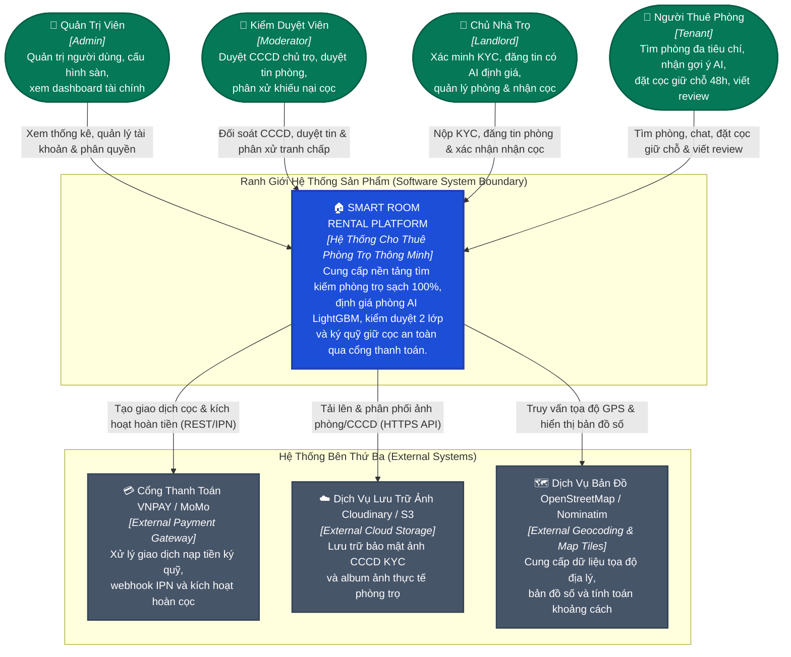

# C1 — Ngữ Cảnh Hệ Thống (System Context)

> **Mục đích:** Thể hiện bức tranh toàn cảnh cấp cao nhất: Ai sử dụng Smart Room Rental Platform, trách nhiệm chính của hệ thống là gì và hệ thống tích hợp với các bên thứ ba nào.

---

## 1. Sơ Đồ Ngữ Cảnh C1 (Mermaid Context Diagram)

---

## 2. Ranh Giới Hệ Thống & Trách Nhiệm (System Boundary & Responsibilities)

### Trong phạm vi hệ thống (In-Scope Responsibilities):
* Quản lý vòng đời tài khoản và phân quyền 4 vai trò qua Spring Security & JWT Bearer.
* Xác minh 2 lớp: Quy trình KYC chủ trọ qua ảnh CCCD và hàng đợi kiểm duyệt tin đăng phòng.
* Tích hợp Trí tuệ Nhân tạo: Mô hình học máy LightGBM dự đoán giá thị trường, Recommender Engine cá nhân hóa theo lịch sử tương tác, và Chatbot tư vấn 24/7.
* Cơ chế Ký quỹ Escrow: Tạm giữ tiền cọc 48 giờ, tự động khóa phòng khi có người cọc, giải ngân cho chủ trọ khi nhận phòng hoặc hoàn tiền 100% khi phát hiện phòng ảo/sai mô tả.
* Đánh giá 2 bước (Verified Reviews): Chỉ người dùng có đơn cọc hoàn tất mới được phép đánh giá.

### Hệ thống bên ngoài tích hợp (External Integration Boundaries):
1. **VNPAY / MoMo Gateway:** Xử lý luồng tiền thực tế, cung cấp chữ ký điện tử an toàn (HMAC SHA512) để xác thực tính toàn vẹn của giao dịch.
2. **Cloudinary / AWS S3:** Giảm tải cho máy chủ ứng dụng bằng cách lưu trữ tệp đa phương tiện trên CDN phân tán toàn cầu.
3. **OpenStreetMap / Leaflet:** Cung cấp lớp bản đồ số trực quan, không phụ thuộc vào các dịch vụ có phí đắt đỏ như Google Maps.
