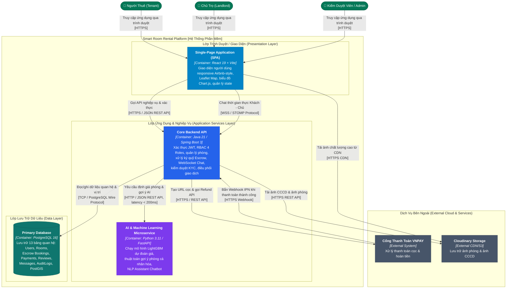

# C2 — Mức Container (Containers Diagram)

> **Mục đích:** Phóng to vào bên trong hệ thống Smart Room Rental Platform để thể hiện các đơn vị thực thi (Run-time Containers), công nghệ sử dụng, phân vùng lưu trữ dữ liệu và các giao thức giao tiếp mạng.

---

## 1. Sơ Đồ Container C2 (Mermaid Container Diagram)

---

## 2. Đặc Tả Chi Tiết Các Container (Container Specifications)

| Tên Container | Vai Trò & Trách Nhiệm | Công Nghệ Cốt Lõi | Cổng & Giao Thức (Protocols) |
| :--- | :--- | :--- | :--- |
| **Web Frontend (SPA)** | Cung cấp toàn bộ trải nghiệm người dùng cho 4 đối tượng: Trang chủ, bản đồ số, portal chủ trọ, dashboard admin. | React 19, Vite, Tailwind CSS, Leaflet Map, Chart.js | Port 3000 (Local) / 443 (HTTPS) |
| **Core Backend API** | Máy chủ ứng dụng trung tâm: Xử lý nghiệp vụ, xác thực JWT, phân quyền, ký quỹ Escrow, WebSocket Chat, kiểm toán. | Java 21, Spring Boot 3.3, Spring Security 6, Spring Data JPA | Port 8080 / HTTPS, WSS |
| **AI Microservice** | Dịch vụ AI độc lập: Chạy mô hình học máy LightGBM định giá phòng, thuật toán gợi ý phòng, chatbot giải đáp tiện ích. | Python 3.11, FastAPI, LightGBM, Scikit-learn, Uvicorn | Port 8000 / HTTP nội bộ |
| **Primary Database** | Lưu trữ dữ liệu quan hệ toàn vẹn, hỗ trợ chỉ mục địa lý PostGIS và lưu trữ cấu trúc linh hoạt qua JSONB. | PostgreSQL 16 (Container Docker `rental-postgres`) | Port 54333 (Local) / 5432 (Docker) |

---

## 3. Giao Thức Giao Tiếp & Ranh Giới Bảo Mật (Network Protocols & Security)

1. **Client - Backend (HTTPS & WSS):**
   - Mọi truy vấn HTTP đều bắt buộc kèm tiêu đề `Authorization: Bearer <TOKEN>` (ngoại trừ các endpoint công khai như tìm kiếm, xem phòng).
   - Chat thời gian thực sử dụng kênh WebSocket STOMP bảo mật qua WSS.
2. **Backend - AI Microservice (Inter-service HTTP):**
   - Giao tiếp đồng bộ qua REST API JSON trong mạng nội bộ Docker.
   - Thời gian chờ (Timeout) tối đa 1.5 giây; nếu AI Service không phản hồi kịp, Backend tự động sử dụng giá trị trung bình quận huyện làm fallback an toàn.
3. **Backend - Cổng Thanh Toán VNPAY (Secure Gateway):**
   - Mọi URL chuyển hướng và Webhook IPN đều được mã hóa và xác thực chữ ký số bằng thuật toán **HMAC SHA512** với Secret Key được bảo vệ nghiêm ngặt trong biến môi trường (`.env`).
