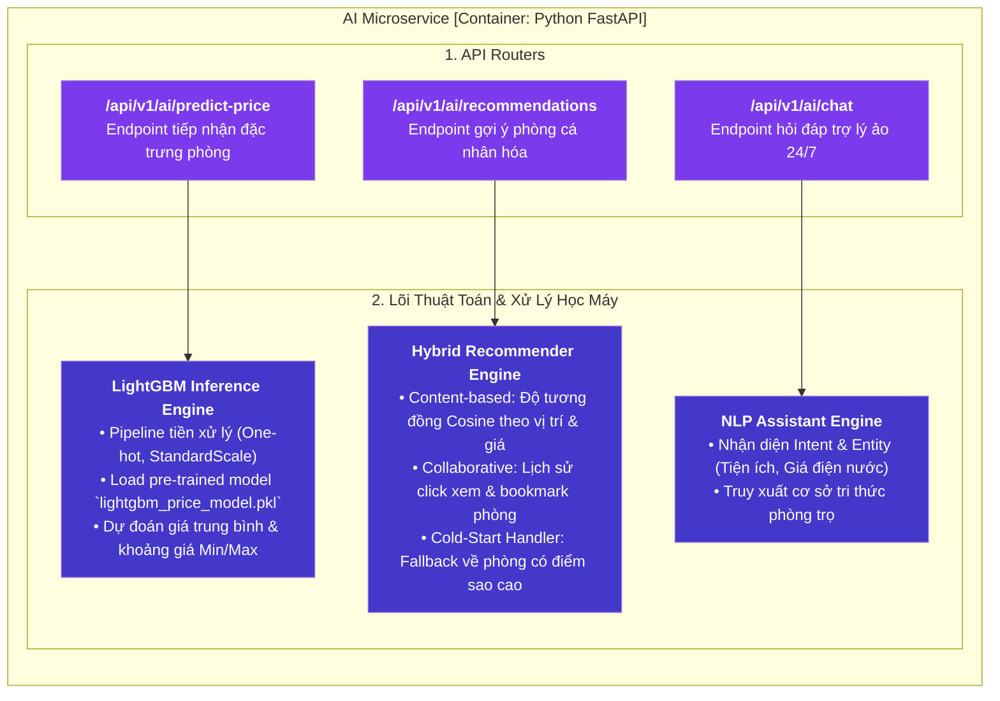

# C3 — Mức Thành Phần (Components Diagram)

> **Mục đích:** Phóng to vào bên trong **Core Backend API (Java Spring Boot 3)** và **AI Microservice (Python FastAPI)** để thể hiện các thành phần mô-đun chức năng nội bộ và luồng dữ liệu giữa chúng.

---

## 1. Thành Phần Nội Bộ Core Backend API (Spring Boot 3)

```mermaid
flowchart TB
    subgraph backendContainer["Core Backend API [Container: Spring Boot 3]"]
        direction TB

        subgraph securityComp["1. Phân Hệ Bảo Mật & Xác Thực"]
            jwtFilter["<b>JwtAuthenticationFilter</b><br/>Bắt giữ request, giải mã JWT,<br/>thiết lập SecurityContext"]
            authService["<b>AuthenticationService</b><br/>Đăng nhập, đăng ký, cấp Access<br/>& Refresh Token qua BCrypt"]
        end

        subgraph businessComp["2. Phân Hệ Dịch Vụ Nghiệp Vụ (Services)"]
            roomService["<b>RoomManagementService</b><br/>Tạo/sửa tin phòng, kiểm tra trạng thái,<br/>xóa mềm, tích hợp dữ liệu AI"]
            kycService["<b>LandlordKycService</b><br/>Tiếp nhận ảnh CCCD, quản lý hàng đợi<br/>duyệt KYC của Moderator"]
            escrowService["<b>EscrowBookingService</b><br/>Quản lý luồng cọc 48h, khóa phòng,<br/>giải ngân cho chủ hoặc bồi hoàn"]
            disputeService["<b>DisputeResolutionService</b><br/>Tiếp nhận khiếu nại phòng sai mô tả,<br/>kích hoạt VNPAY Refund API"]
            chatService["<b>RealtimeChatService</b><br/>Điều phối tin nhắn WebSocket STOMP,<br/>lưu trữ lịch sử hội thoại"]
            reviewService["<b>VerifiedReviewService</b><br/>Kiểm tra điều kiện đã thuê thực tế,<br/>tính toán điểm sao trung bình"]
            analyticsService["<b>AnalyticsService</b><br/>Tổng hợp doanh thu cọc, tỷ lệ phòng trống,<br/>báo cáo vi phạm cho Admin"]
        end

        subgraph integrationComp["3. Phân Hệ Tích Hợp (Clients & Adapters)"]
            aiClient["<b>AiServiceWebClient</b><br/>Gọi REST API sang Python FastAPI<br/>để lấy giá LightGBM & gợi ý"]
            vnpayClient["<b>VnpayPaymentClient</b><br/>Tạo URL ký quỹ & gọi Refund API<br/>xác thực chữ ký HMAC SHA512"]
            storageClient["<b>CloudinaryStorageAdapter</b><br/>Tải ảnh CCCD & album phòng lên Cloud"]
        end

        subgraph dataComp["4. Phân Hệ Truy Cập Dữ Liệu (Repositories)"]
            userRepo["UserRepository"]
            roomRepo["RoomRepository"]
            escrowRepo["EscrowBookingRepository"]
            paymentRepo["PaymentRepository"]
            disputeRepo["DisputeRepository"]
            reviewRepo["ReviewRepository"]
            auditRepo["AuditLogRepository"]
        end
    end

    %% Luồng liên kết nội bộ
    jwtFilter --> authService
    authService --> userRepo

    roomService --> roomRepo
    roomService --> aiClient
    roomService --> storageClient

    kycService --> userRepo
    kycService --> storageClient

    escrowService --> escrowRepo
    escrowService --> roomRepo
    escrowService --> vnpayClient
    escrowService --> paymentRepo

    disputeService --> disputeRepo
    disputeService --> escrowService
    disputeService --> vnpayClient

    chatService --> userRepo
    reviewService --> reviewRepo
    analyticsService --> escrowRepo & roomRepo & auditRepo

    classDef secStyle fill:#dc2626,color:#fff;
    classDef srvStyle fill:#2563eb,color:#fff;
    classDef clientStyle fill:#7c3aed,color:#fff;
    classDef repoStyle fill:#0f766e,color:#fff;

    class jwtFilter,authService secStyle;
    class roomService,kycService,escrowService,disputeService,chatService,reviewService,analyticsService srvStyle;
    class aiClient,vnpayClient,storageClient clientStyle;
    class userRepo,roomRepo,escrowRepo,paymentRepo,disputeRepo,reviewRepo,auditRepo repoStyle;
```

---

## 2. Thành Phần Nội Bộ AI Microservice (Python FastAPI)

