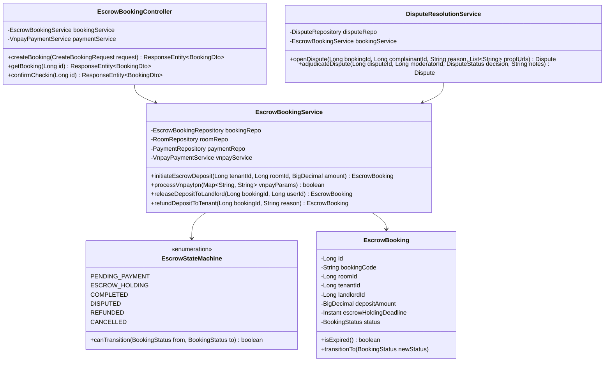
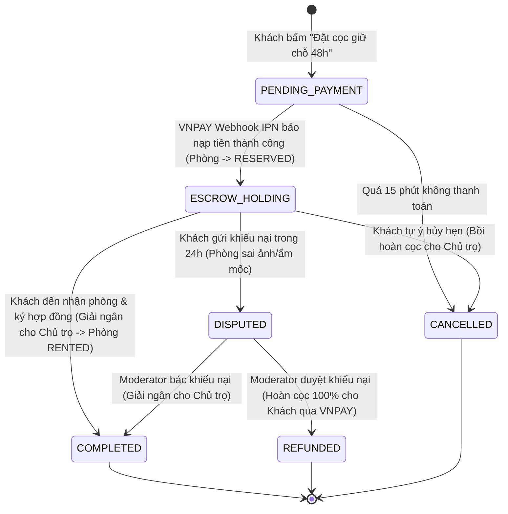
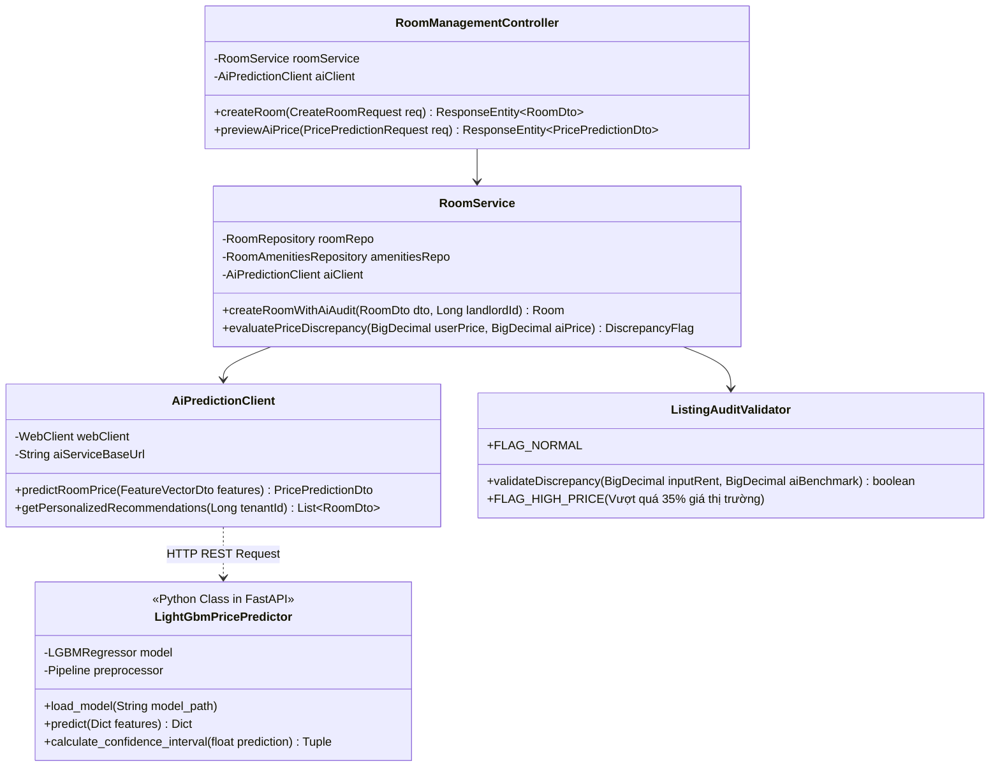
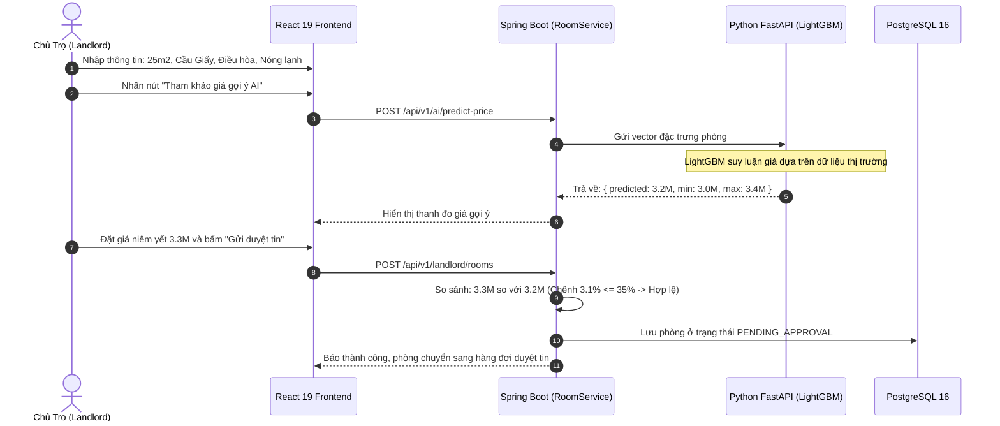

# C4 — Mức Mã Nguồn (Code Level Architecture)

> **Mục đích:** Đi sâu vào cấu trúc mã nguồn đối tượng (Class Design), mẫu thiết kế (Design Patterns) và máy trạng thái (State Machine) của **2 tính năng cốt lõi quan trọng nhất** của dự án:
> 1. Quy trình Ký quỹ Giữ phòng 48h & Phân xử tranh chấp (`Escrow Booking & Dispute Resolution`).
> 2. Quy trình Định giá phòng AI LightGBM & Kiểm duyệt tin (`Real-time AI Price Prediction & Listing Audit`).

---

## 1. Tính Năng Cốt Lõi 1: Quy Trình Đặt Cọc Ký Quỹ Escrow (Escrow Booking)

### 1.1 Sơ Đồ Lớp (Class Diagram)

### 1.2 Máy Trạng Thái Đơn Cọc Ký Quỹ (Escrow Booking State Machine)

---

## 2. Tính Năng Cốt Lõi 2: Định Giá Phòng AI LightGBM & Kiểm Duyệt Tin

### 2.1 Sơ Đồ Lớp (Class Diagram)

### 2.2 Luồng Logic Định Giá & Phê Duyệt Tin (Listing Creation Flow)

