# Mô Hình Kiến Trúc C4 — Smart Room Rental Platform

> **Tiêu chuẩn thiết kế:** C4 Model (Context, Containers, Components, Code)  
> **Trạng thái:** TARGET V1 BASELINE  
> **Kiến trúc:** Java Spring Boot 3 + React 19 + Python FastAPI (LightGBM) + PostgreSQL 16

---

## 1. Tổng Quan Mô Hình C4 (C4 Hierarchy Overview)

Mô hình C4 chia sẻ kiến trúc hệ thống theo 4 mức độ phóng to (**Zoom Levels**) từ ngoài vào trong:

```mermaid
flowchart LR
    C1["<b>C1 · System Context</b><br/><small>Ai sử dụng hệ thống & hệ thống làm gì?</small>"]
    C2["<b>C2 · Container</b><br/><small>Các đơn vị thực thi & lưu trữ nào cấu thành hệ thống?</small>"]
    C3["<b>C3 · Component</b><br/><small>Cấu trúc nội bộ của Backend & AI Service?</small>"]
    C4["<b>C4 · Code</b><br/><small>Thiết kế hướng đối tượng & luồng xử lý 2 tính năng cốt lõi?</small>"]

    C1 -->|"Zoom vào Hệ thống Smart Rental"| C2
    C2 -->|"Zoom vào Spring Boot & FastAPI"| C3
    C3 -->|"Zoom vào Ký quỹ Escrow & Định giá AI"| C4

    style C1 fill:#0284c7,color:#fff,stroke:#0369a1,stroke-width:2px
    style C2 fill:#0284c7,color:#fff,stroke:#0369a1,stroke-width:2px
    style C3 fill:#0284c7,color:#fff,stroke:#0369a1,stroke-width:2px
    style C4 fill:#0284c7,color:#fff,stroke:#0369a1,stroke-width:2px
```

---

## 2. Bảng Danh Mục Tài Liệu C4

| Cấp Độ (Level) | Tệp Tài Liệu | Mục Tiêu & Trọng Tâm | Công Nghệ / Ngôn Ngữ Biểu Diễn |
| :---: | :--- | :--- | :--- |
| **C1** | [`01-system-context.md`](./01-system-context.md) | Ngữ cảnh hệ thống: 4 nhóm tác nhân và các hệ thống bên thứ ba (VNPAY, Cloudinary, OpenStreetMap). | Mermaid Flowchart Context |
| **C2** | [`02-container.md`](./02-container.md) | Phân rã Container: Frontend React 19, Core Backend Spring Boot 3, AI Microservice FastAPI, PostgreSQL 16. | Mermaid Flowchart Container + Protocol Specs |
| **C3** | [`03-component.md`](./03-component.md) | Phân rã Thành phần nội bộ của Core Backend và Microservice AI (Inference Engine, Recommender, Chatbot). | Mermaid Flowchart Component |
| **C4** | [`04-code.md`](./04-code.md) | Thiết kế mức mã nguồn (Class diagrams, State Machines) cho 2 nghiệp vụ cốt lõi: Đặt cọc Escrow & Định giá LightGBM. | Mermaid Class Diagrams & Flowcharts |

---

## 3. Quy Ước Bảng Màu Chuẩn C4 Model

* 👤 **Tác nhân người dùng (Person):** `fill:#047857` (Xanh lá đậm)
* 🏢 **Hệ thống phần mềm trung tâm (Software System):** `fill:#1d4ed8` (Xanh dương)
* 📦 **Container thực thi (Container):** `fill:#2563eb` (Xanh dương vừa)
* 🧩 **Thành phần chức năng (Component):** `fill:#3b82f6` (Xanh dương nhạt)
* ☁️ **Hệ thống bên thứ ba (External System):** `fill:#475569` (Xám đá)
* 🗄️ **Cơ sở dữ liệu (Database):** `fill:#0f766e` (Xanh mòng két)
