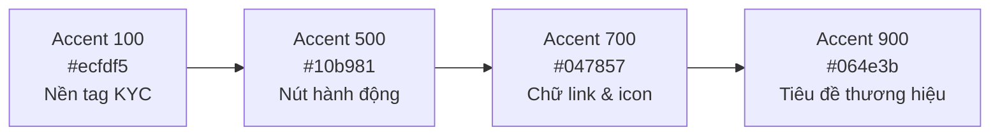

# Tài Liệu Hệ Thống Thiết Kế (Design System & Token Contract)

> **Dự án:** Sàn Cho Thuê Phòng Trọ Thông Minh (Smart Room Rental Platform)  
> **Chuẩn tham chiếu:** Hệ thống Token & Nguyên tắc Thiết kế FlowX (`d:\FlowX\samples\crm-web\src\design\tokens.css`)  
> **Nguyên tắc cốt lõi:**  
> 1. **Two-Layer Token Architecture:** Tách biệt tuyệt đối giữa *Hợp đồng Token* (tên biến, ý nghĩa ngữ nghĩa) và *Giá trị chủ đề* (mã màu cụ thể). Không component nào trong ứng dụng được phép hardcode mã màu hex/rgb trực tiếp.  
> 2. **Shared Lightness Scale:** Toàn bộ các nấc màu từ 100 đến 900 của các dải màu (Neutral, Primary, Status) đều chia sẻ cùng một thang độ sáng (*perceptual lightness*), giúp viền và nền khi phối hợp luôn hài hòa tự nhiên.  
> 3. **Accessibility First (WCAG 2.1 AA):** Mọi văn bản hiển thị trên nền trắng hoặc xám nhạt đều bắt buộc đạt tỷ lệ tương phản tối thiểu $4.5:1$.

---

## 1. Bảng Khế Ước Biến Thiết Kế (Design Tokens Contract)

### 1.1 Màu Nền Cơ Bản (Ground Tokens)
| Token | Giá Trị HEX | Mục Đích Sử Dụng |
| :--- | :--- | :--- |
| `--color-bg` | `#f8fafc` | Màu nền toàn trang (Slate 50), tạo cảm giác dịu mắt và tôn khối nội dung. |
| `--color-surface` | `#ffffff` | Màu nền của Card, Container, Modal, Table và Sidebar. |
| `--color-surface-hover` | `#f1f5f9` | Màu nền khi di chuột qua hàng bảng hoặc danh sách phòng. |
| `--color-divider` | `#e2e8f0` | Màu đường kẻ phân cách bảng, ranh giới khối và viền thẻ. |
| `--color-text` | `#0f172a` | Màu chữ chính (Slate 900), đạt độ tương phản cực đại trên nền trắng. |
| `--color-text-muted` | `#64748b` | Màu chữ phụ (Slate 500), dùng cho nhãn mô tả, ngày tháng, diện tích $m^2$. |

---

### 1.2 Dải Màu Trung Tính (Neutral Ramp)
Dùng cho phân cấp văn bản, viền component, nền phụ và bóng đổ:

| Nấc (Step) | Token | Giá Trị HEX | Ứng Dụng Trong Hệ Thống |
| :---: | :--- | :--- | :--- |
| `100` | `--color-neutral-100` | `#ffffff` | Nền thẻ trắng tinh. |
| `200` | `--color-neutral-200` | `#f8fafc` | Nền trang tổng thể. |
| `300` | `--color-neutral-300` | `#f1f5f9` | Nền input vô hiệu hóa (disabled), chip chưa chọn. |
| `400` | `--color-neutral-400` | `#e2e8f0` | Viền input, viền card, đường kẻ phân cách tab. |
| `500` | `--color-neutral-500` | `#94a3b8` | Placeholder chữ mờ trong ô tìm kiếm. |
| `600` | `--color-neutral-600` | `#64748b` | Text thứ cấp (Secondary text, nhãn thời gian, diện tích). |
| `700` | `--color-neutral-700` | `#475569` | Text nhãn form (Input label), tiêu đề phụ. |
| `800` | `--color-neutral-800` | `#1e293b` | Tiêu đề card, tên phòng trọ, tên chủ nhà. |
| `900` | `--color-neutral-900` | `#0f172a` | Tiêu đề trang chính (H1, H2), số tiền lớn. |

---

### 1.3 Dải Màu Thương Hiệu & Điểm Nhấn (Brand & Accent Ramp)
Sử dụng tông **Emerald Green** (Đại diện cho sự an tâm, tin cậy, phòng trọ sạch) phối cùng **Royal Indigo** (Đại diện cho công nghệ AI và bảo chứng Escrow):

| Nấc (Step) | Token | Giá Trị HEX | Ý Nghĩa Trong Giao Diện |
| :---: | :--- | :--- | :--- |
| `100` | `--color-accent-100` | `#ecfdf5` | Nền huy hiệu "Đã duyệt KYC", "Tin phòng xác minh". |
| `200` | `--color-accent-200` | `#d1fae5` | Viền badge thành công, nền highlight kết quả tìm kiếm. |
| `300` | `--color-accent-300` | `#6ee7b7` | Vạch đo đồng hồ AI mức giá an toàn. |
| `400` | `--color-accent-400` | `#34d399` | Đồ họa trực quan, chấm xanh trạng thái online. |
| `500` | `--color-accent-500` | `#10b981` | Màu chủ đạo nút bấm CTA: "Đặt cọc 48h", "Duyệt tin". |
| `600` | `--color-accent-600` | `#059669` | Trạng thái hover của nút bấm chính. |
| `700` | `--color-accent-700` | `#047857` | Màu chữ liên kết, icon thương hiệu. |
| `800` | `--color-accent-800` | `#065f46` | Trạng thái active/press của nút chính. |
| `900` | `--color-accent-900` | `#064e3b` | Điểm nhấn thương hiệu đậm. |

* **Màu phụ trợ AI (AI Core Purple):**
  - `--color-ai-primary`: `#7c3aed` (Tím công nghệ AI).
  - `--color-ai-bg`: `#f5f3ff` (Nền badge "Gợi ý bởi AI", "Định giá LightGBM").
  - `--color-ai-border`: `#ddd6fe` (Viền widget đo giá AI).

---

### 1.4 Màu Trạng Thái Nghiệp Vụ (Business Status Tokens)
Đặc tả rõ ràng cho quy trình Ký quỹ Escrow và Trạng thái kiểm duyệt:

| Trạng Thái Nghiệp Vụ | Token Màu Chữ / Viền | Token Màu Nền | Ý Nghĩa Sử Dụng |
| :--- | :--- | :--- | :--- |
| **AVAILABLE (Còn trống)** | `--color-status-success: #15803d` | `--color-status-success-bg: #f0fdf4` | Phòng sẵn sàng cho thuê, cọc thành công. |
| **ESCROW_HOLDING (Đang giữ cọc)** | `--color-status-warning: #b45309` | `--color-status-warning-bg: #fffbeb` | Tiền cọc đang tạm giữ 48h, phòng chuyển `RESERVED`. |
| **DISPUTED (Đang khiếu nại)** | `--color-status-danger: #b91c1c` | `--color-status-danger-bg: #fef2f2` | Khách khiếu nại phòng sai thực tế, chờ Moderator. |
| **COMPLETED (Hoàn tất)** | `--color-status-info: #0369a1` | `--color-status-info-bg: #f0f9ff` | Khách đã nhận phòng, giải ngân cho chủ trọ. |
| **FLAG_HIGH_PRICE (Lệch giá AI)** | `--color-status-flag: #c2410c` | `--color-status-flag-bg: #fff7ed` | Cờ cảnh báo giá chủ trọ hét cao hơn $>35\%$ so với AI. |

---

### 1.5 Quy Chuẩn Kiểu Chữ (Typography Scale)
* **Font gia đình (Font Families):**
  - Font tiêu đề (`--font-heading`): `-apple-system, BlinkMacSystemFont, 'Inter', 'Segoe UI', sans-serif`.
  - Font nội dung (`--font-body`): `'Inter', -apple-system, BlinkMacSystemFont, sans-serif`.
  - Font mã số / Tiền tệ (`--font-mono`): `'JetBrains Mono', 'Fira Code', monospace` (Dùng cho Mã đơn cọc, Tọa độ GPS, Giá thuê).
* **Thang cỡ chữ (Type Scale):**
  - `Display / Hero Title`: $32\text{px} - 36\text{px}$ / Line-height $1.15$ / Font-weight $700$ (Trang chủ tìm kiếm).
  - `Heading 1 (H1)`: $24\text{px} - 28\text{px}$ / Line-height $1.2$ / Font-weight $700$ (Tiêu đề trang, Chi tiết phòng).
  - `Heading 2 (H2)`: $20\text{px}$ / Line-height $1.25$ / Font-weight $600$ (Tiêu đề từng phân đoạn).
  - `Heading 3 (H3)`: $16\text{px}$ / Line-height $1.3$ / Font-weight $600$ (Tiêu đề thẻ phòng, Tên tiện nghi).
  - `Body Regular`: $14.5\text{px}$ / Line-height $1.5$ / Font-weight $400$ (Văn bản mô tả, bình luận).
  - `Body Small / Caption`: $12.5\text{px}$ / Line-height $1.4$ / Font-weight $500$ (Nhãn phụ, khoảng cách ĐH, timestamp).

---

### 1.6 Quy Chuẩn Khoảng Cách (Spacing Grid 4px / 8px)
* `--space-1`: $4\text{px}$ (Khoảng cách icon và chữ nhỏ)
* `--space-2`: $8\text{px}$ (Khoảng cách giữa các chip lọc, padding nhỏ)
* `--space-3`: $12\text{px}$ (Khoảng cách giữa các dòng form, padding input)
* `--space-4`: $16\text{px}$ (Padding mặc định của Card, Button chuẩn)
* `--space-6`: $24\text{px}$ (Khoảng cách giữa các cột, lưới phòng trọ)
* `--space-8`: $32\text{px}$ (Khoảng cách giữa các phần trong trang)
* `--space-12`: $48\text{px}$ (Khoảng cách lớn giữa các Section)

---

### 1.7 Độ Bo Góc (Geometry / Border Radius)
* `--radius-sm`: $6\text{px}$ (Nút bấm nhỏ, Tag trạng thái, ô Input)
* `--radius-md`: $10\text{px}$ (Nút bấm chuẩn CTA, Dropdown, Menu)
* `--radius-lg`: $16\text{px}$ (Thẻ phòng trọ Card, Khung tìm kiếm Hero, Modal)
* `--radius-full`: $9999\text{px}$ (Pill badge, Avatar tròn, Nút icon tròn)

---

### 1.8 Chiều Sâu & Bóng Đổ (Elevation & Shadows)
* `--shadow-sm`: `0 1px 2px 0 rgba(0, 0, 0, 0.05)` (Dành cho Card phẳng, viền input lúc hover)
* `--shadow-md`: `0 4px 6px -1px rgba(0, 0, 0, 0.08), 0 2px 4px -2px rgba(0, 0, 0, 0.06)` (Thẻ phòng khi hover nổi lên)
* `--shadow-lg`: `0 10px 15px -3px rgba(0, 0, 0, 0.1), 0 4px 6px -4px rgba(0, 0, 0, 0.08)` (Dropdown menu, Drawer hàng đợi kiểm duyệt)
* `--shadow-modal`: `0 20px 25px -5px rgba(0, 0, 0, 0.15), 0 8px 10px -6px rgba(0, 0, 0, 0.1)` (Hộp thoại đối soát CCCD, Xác nhận cọc)

