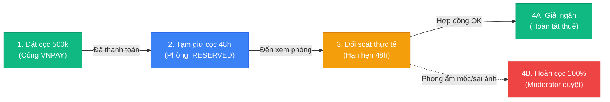

# Danh Mục Thành Phần Giao Diện (Component Library Specifications)

> **Dự án:** Sàn Cho Thuê Phòng Trọ Thông Minh (Smart Room Rental Platform)  
> **Tham chiếu chuẩn:** Thư viện Primitives của FlowX (`d:\FlowX\samples\crm-web\src\design\primitives`)  
> **Nguyên tắc phân tầng:**  
> - **Tầng 1 (Core Primitives):** Hoàn toàn độc lập nghiệp vụ, tái sử dụng trên mọi trang.  
> - **Tầng 2 (Domain Components):** Thành phần chuyên biệt cho sàn phòng trọ (Thẻ phòng, Bản đồ, Thước đo giá AI, Thanh tiến trình Escrow, Đánh giá sau lưu trú).

---

## 1. Các Thành Phần Cơ Sở (Core Primitives)

### 1.1 Nút Bấm (Button Primitives)
```text
[ Primary CTA ]   [ Secondary ]   [ Destructive / Danger ]   [ Ghost / Link ]
```
* **Biến thể (Variants):**
  - `primary`: Nền `--color-accent-500`, chữ trắng, bo góc `md`. Dành cho hành động chính: "Đặt cọc giữ chỗ 48h", "Tìm kiếm", "Gửi duyệt tin".
  - `secondary`: Nền trắng, viền `--color-neutral-400`, chữ `--color-neutral-800`. Dành cho: "Lọc phòng", "Lưu tin", "Quay lại".
  - `danger`: Nền `--color-status-danger`, chữ trắng. Dành cho: "Từ chối KYC", "Khóa tài khoản", "Khiếu nại cọc".
  - `ai`: Nền `--color-ai-primary` (tím), chữ trắng kèm icon sao AI. Dành cho: "Tham khảo giá gợi ý AI LightGBM".
* **Kích thước (Sizes):**
  - `sm`: Chiều cao $32\text{px}$, font $12.5\text{px}$ (Dùng trong bảng danh sách, thẻ phòng).
  - `md`: Chiều cao $40\text{px}$, font $14\text{px}$ (Nút chuẩn form nhập liệu).
  - `lg`: Chiều cao $48\text{px}$, font $16\text{px}$ (Nút đặt cọc Hero, Xác nhận thanh toán).
* **Trạng thái:** `default`, `hover`, `active`, `loading` (Spinner quay mượt), `disabled`.

---

### 1.2 Bảng Dữ Liệu Chuyên Sâu (DataTable Primitive)
Áp dụng cho Hàng đợi Duyệt KYC (`SCR-13`), Duyệt tin (`SCR-14`), Phân xử khiếu nại (`SCR-15`), Quản lý phòng của chủ (`SCR-10`) và Quản trị người dùng (`SCR-16`):
* **Tính năng bắt buộc:**
  - Tiêu đề cột hỗ trợ Sort hai chiều (Tên, Giá, Ngày gửi, Trạng thái).
  - Ghim dòng tiêu đề (Sticky Header) khi cuộn bảng dài.
  - Cột hành động cố định bên phải (Nút Phê duyệt, Xem chi tiết, Menu thao tác nhanh).
  - Hàng phân trang chuẩn: Hiển thị "Trang 1 / 10 · Tổng 120 bản ghi", chọn số lượng hiển thị (10, 25, 50).

---

### 1.3 Thẻ Chỉ Số KPI (StatTile Primitive)
Dành cho Dashboard Admin (`SCR-17`) và Tổng quan Chủ trọ (`SCR-10`):
```text
┌──────────────────────────────────────────────┐
│ TỔNG DOANH THU HOA HỒNG SÀN                  │
│ 148,500,000 VNĐ                              │
│ [ ▲ +18.4% so với tháng trước ]  (Tháng 11) │
└──────────────────────────────────────────────┘
```
* **Cấu trúc:** Nhãn định danh (Eyebrow), Giá trị chữ số lớn (Font Mono 28px), Huy hiệu xu hướng (Trend Badge xanh/đỏ) và chu kỳ đối soát.

---

### 1.4 Hộp Thoại & Ngăn Kéo Kiểm Duyệt (Modal & Drawer)
* **Audit Drawer (Ngăn kéo kiểm duyệt trượt từ phải sang):**
  - Chiều rộng $480\text{px} - 600\text{px}$.
  - Giúp Moderator kiểm tra ảnh CCCD gốc, đối chiếu ảnh phòng thực tế mà không bị rời khỏi danh sách hàng đợi.
* **Confirmation Modal (Hộp thoại xác nhận cọc):**
  - Cảnh báo rõ ràng số tiền ký quỹ, cam kết hoàn tiền 100% và thời hạn đếm ngược 48h.

---

### 1.5 Bộ 3 Trạng Thái Chuẩn Mực (States: Loading, Empty, Error)
Mọi trang web đều bắt buộc hiện thực đủ 3 trạng thái để tránh hiện tượng màn hình trắng:
* **Skeleton Loading:** Khung xương xám chuyển động nhẹ (Shimmer animation) mô phỏng chính xác layout của Card hoặc Table khi đang chờ Backend.
* **EmptyState (Trạng thái rỗng):**
  - Hình minh họa thân thiện.
  - Dòng thông báo rõ ràng: "Không tìm thấy phòng trọ nào quanh bán kính 2km trường ĐH Bách Khoa".
  - Nút kêu gọi hành động (CTA): "Xóa bộ lọc" hoặc "Mở rộng bán kính tìm kiếm".
* **ErrorState (Trạng thái lỗi):**
  - Trích xuất thông điệp từ chuẩn `ErrorResponse` của Backend: Báo lỗi có nguyên nhân cụ thể và nút "Thử lại".

---

## 2. Các Thành Phần Nghiệp Vụ Sàn Phòng Trọ (Domain Components)

---

### 2.1 Thẻ Phòng Trọ Chuẩn Airbnb (RoomCard)
Thành phần xuất hiện tại Trang chủ (`SCR-01`) và Danh sách tìm kiếm (`SCR-02`):

```text
┌────────────────────────────────────────────────────────┐
│ [ Ảnh bìa phòng trọ thực tế - Tỷ lệ 4:3 ]            │
│  [Badge: ĐÃ KIỂM DUYỆT 🛡️]   [Badge: GIÁ TỐT THEO AI ⚡]│
│  [Nút Trái Tim Yêu Thích ♡]                           │
├────────────────────────────────────────────────────────┤
│ Phòng Studio Full Đồ Ban Công Thoáng Mát               │
│ 📍 Ngõ 165 Cầu Giấy, Hà Nội · Cách ĐH Sư Phạm 650m     │
│ 📐 28 m²  ·  👥 Tối đa 2 người  ·  ⭐ 4.9 (18 đánh giá)│
│                                                        │
│ 🏷️ Tiện ích: [Điều hòa] [Nóng lạnh] [Máy giặt] [Giờ tự do]
├────────────────────────────────────────────────────────┤
│ 3,200,000 đ/tháng             [ Xem Chi Tiết -> ]      │
└────────────────────────────────────────────────────────┘
```
* **Quy chuẩn hiển thị:**
  - Ảnh đại diện có tỷ lệ cố định $4:3$, bo góc trên `16px`.
  - Huy hiệu góc trái: Badge xanh "Đã kiểm duyệt", Badge tím "Giá tốt theo AI".
  - Hiển thị khoảng cách chính xác đến mốc trường Đại học người dùng đang quan tâm.
  - Giá thuê nổi bật bằng Font Mono màu đen đậm, định dạng dấu phẩy tiếng Việt (`3,200,000 đ/tháng`).

---

### 2.2 Đồng Hồ Đo Định Giá AI LightGBM (AiPriceGauge)
**USP Đột phá của đề tài** — Xuất hiện trên Trang Chi tiết phòng (`SCR-03`), Form tạo tin (`SCR-11`) và Hàng đợi duyệt tin (`SCR-14`):

```text
┌─────────────────────────────────────────────────────────────────────────┐
│ 🤖 ĐỊNH GIÁ THỊ TRƯỜNG TỰ ĐỘNG BẰNG AI (LIGHTGBM ENGINE)               │
├─────────────────────────────────────────────────────────────────────────┤
│ Mức giá chủ trọ đặt:  3,200,000 đ                                       │
│ Khoảng giá khuyến nghị: [ 3,000,000 đ  ──────  3,500,000 đ ]            │
│                                                                         │
│  Thấp hơn         Khoảng giá an toàn thị trường         Cao hơn         │
│ [ < 3.0M ] ─────── [ 3.0M ──────●────── 3.5M ] ─────── [ > 3.5M ]       │
│                               ▲ (Giá niêm yết: 3.2M)                    │
│                                                                         │
│ 💡 Đánh giá AI: MỨC GIÁ HỢP LÝ VỚI THỊ TRƯỜNG                           │
│     (Dựa trên 28m2, Quận Cầu Giấy, có điều hòa, nóng lạnh, máy giặt)    │
└─────────────────────────────────────────────────────────────────────────┘
```
* **Cơ chế màu sắc thông minh của thước đo:**
  - **Vùng Xanh Lá (Safe Range $[Y_{\min}, Y_{\max}]$):** Giá niêm yết nằm trong khoảng AI đề xuất $\rightarrow$ Hiển thị badge xanh: *"Giá hợp lý, an tâm đặt cọc"*.
  - **Vùng Vàng Cam (Giá thấp hơn $Y_{\min}$):** Giá rẻ hơn đáng kể $\rightarrow$ Badge vàng: *"Mức giá rất cạnh tranh, phòng có thể hết sớm"*.
  - **Vùng Đỏ Cảnh Báo (Vượt ngưỡng $>35\%$ so với AI):** Hệ thống tự động kích hoạt cờ `FLAG_HIGH_PRICE` $\rightarrow$ Moderator sẽ yêu cầu chủ trọ giải trình cơ sở vật chất đặc thù trước khi cho phép xuất bản.

---

### 2.3 Bản Đồ Số Định Vị & Vòng Tròn Bán Kính (InteractiveMap)
Xuất hiện tại Trang tìm kiếm (`SCR-02`) và Trang Chi tiết (`SCR-03`):
* Tích hợp thư viện Leaflet / OpenStreetMap.
* **Ghim phòng (Custom Price Pins):** Mỗi phòng được hiển thị dưới dạng viên thuốc (Pill Marker) mang giá tiền (ví dụ: `3.2Tr`). Khi di chuột hoặc click, ghim đổi sang màu xanh thương hiệu và phóng to Card xem nhanh.
* **Cụm ghim MarkerCluster:** Tự động gom các phòng gần nhau thành vòng tròn số lượng (`15+ phòng`) khi zoom xa, tự bung ra khi zoom gần.
* **Lớp phủ bán kính đại học (Radius Circle Overlay):** Vẽ vòng tròn bán kính $1\text{km}, 2\text{km}, 3\text{km}$ mờ với tâm là trường Đại học đã chọn (Bách Khoa, Quốc Gia, Kinh Tế Quốc Dân...).

---

### 2.4 Thanh Tiến Trình Đặt Cọc Ký Quỹ (EscrowTimelineBar)
Xuất hiện tại Trang đặt cọc (`SCR-04`) và Quản lý đơn cọc (`SCR-12`):


* **Đồng hồ đếm ngược 48h thời gian thực (Countdown Timer):**
  - Hiển thị sinh động: `⏳ Còn lại: 36 giờ 42 phút để đến xem phòng`.
  - Nếu khách đến xem thấy đúng mô tả: Chủ trọ hoặc Khách bấm *"Xác nhận đã nhận phòng"* $\rightarrow$ Sàn giải ngân tiền cọc.
  - Nếu phòng sai thực tế: Nút *"Gửi khiếu nại hoàn tiền"* luôn nổi bật trong vòng 24h.

---

### 2.5 Khung Đánh Giá 2 Bước Đã Xác Minh (VerifiedReviewCard)
Xuất hiện tại Trang chi tiết phòng (`SCR-03`) và Lịch sử đánh giá (`SCR-06`):
* **Huy hiệu bảo chứng:** `🛡️ KHÁCH THUÊ THỰC TẾ ĐÃ XÁC MINH (Giao dịch cọc #BK-0089)`.
* **Chấm điểm chi tiết 4 tiêu chí:**
  - 🛡️ An ninh: ⭐⭐⭐⭐⭐ (5/5)
  - 🧹 Vệ sinh: ⭐⭐⭐⭐☆ (4/5)
  - 💡 Điện nước: ⭐⭐⭐⭐⭐ (5/5)
  - 🤝 Chủ trọ: ⭐⭐⭐⭐⭐ (5/5)
* **Album ảnh đính kèm của người thuê:** Khách tự chụp hiện trạng căn phòng tải lên để cộng đồng kiểm chứng chéo với ảnh của chủ trọ.
* **Phản hồi chính thức của Chủ trọ:** Khung trả lời lõm vào (Indented reply block) với nhãn "Chủ trọ phản hồi".

