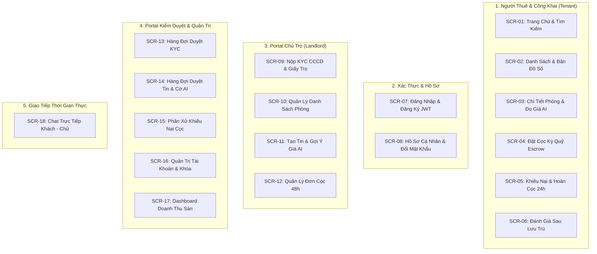

# Tài Liệu Thiết Kế UI/UX & Giao Diện — Smart Room Rental Platform

> **Tiêu chuẩn thiết kế:** Tham chiếu kiến trúc UI/UX từ `FlowX` (`d:\FlowX\samples\crm-web`).  
> **Quy mô hệ thống:** Bao phủ toàn diện **18 màn hình** (`SCR-01` đến `SCR-18`) của 4 nhóm vai trò (`TENANT`, `LANDLORD`, `MODERATOR`, `ADMIN`).  
> **Trạng thái:** TARGET V1 BASELINE (Sẵn sàng đưa vào lập trình React 19).

---

## 1. Mục Lục Bộ Hồ Sơ UI/UX

| STT | Tài Liệu | Nội Dung Trọng Tâm | Liên Kết |
| :---: | :--- | :--- | :--- |
| **01** | **Hệ Thống Thiết Kế (Design System)** | Hợp đồng Design Tokens 2 lớp (Ground, Neutral ramp, Emerald Accent, Business Status, Typography, Spacing 4px/8px, Geometry, Shadows). | [`01-design-system.md`](./01-design-system.md) |
| **02** | **Thư Viện Component (Component Library)** | Đặc tả Primitives (Button, DataTable, StatTile, Modal/Drawer, States) và Component nghiệp vụ (RoomCard, Đồng hồ đo giá AI LightGBM, InteractiveMap, EscrowTimelineBar, VerifiedReviewCard). | [`02-component-library.md`](./02-component-library.md) |
| **03** | **Đặc Tả 18 Màn Hình (Screen Specifications)** | Bản vẽ Wireframe trực quan (ASCII Mockup), cấu trúc phân vùng, luồng tương tác và 4 trạng thái (*Default, Loading, Empty, Error*) cho toàn bộ 18 màn hình. | [`03-screen-specifications.md`](./03-screen-specifications.md) |

---

## 2. Ma Trận 18 Màn Hình × 4 Vai Trò Người Dùng

---

## 3. Ba Điểm Nhấn Thiết Kế Kế Thừa Từ FlowX

1. **Hợp đồng Token không chứa mã màu cứng (Zero literal colors):** Toàn bộ component sử dụng biến CSS `--color-*`, đảm bảo khả năng đổi chủ đề (Theming / Dark mode) chỉ cần can thiệp tại `tokens.css`.
2. **Khung vỏ ứng dụng (AppShell) kết hợp Persona Switcher:** Cho phép Mentor/Ban giám khảo hoặc Lập trình viên chuyển nhanh giữa 4 vai trò (`Tenant`, `Landlord`, `Moderator`, `Admin`) để kiểm thử ngay sự khác biệt phân quyền trên cùng một giao diện.
3. **Phản hồi từ chối quyền (403 Stance) rõ ràng:** Khi người dùng chưa đủ quyền truy cập (ví dụ: Chủ trọ chưa KYC cố đăng tin, Khách chưa nhận phòng cố viết review), giao diện không hiện trang trắng vô nghĩa mà hiển thị thông báo nghiệp vụ kèm nút hướng dẫn khắc phục cụ thể.

